# TP10 – DevSecOps « Shift Left » : secrets, SAST, dépendances, image et quality gates

**Étudiante :** Amal Jemli – Master DevOps et Cloud Computing (2026/2027)
**Énoncé :** [TP10 : DevSecOps Shift Left](https://docs.teknolabs.net/courses/devops-cloud/partie-4-cicd-devsecops/tp10-devsecops-shift-left/)
**Code de l'application vulnérable :** [github.com/Amal356/vuln-app](https://github.com/Amal356/vuln-app) (parties 1 à 5)
**Pipeline Jenkins :** [`../Jenkinsfile`](../Jenkinsfile) de ce dépôt, sur `contact-api` (partie 6)

Objectif : déplacer la sécurité **le plus tôt possible** dans le cycle de développement (« shift left ») :
sur le poste du développeur (hook pre-commit), dans chaque Pull Request (GitHub Actions, CodeQL, Dependabot, ruleset)
et dans le pipeline d'intégration continue (Jenkins). Chaque outil est d'abord lancé à la main sur une application
**volontairement vulnérable**, les failles sont corrigées, puis l'outil devient une **barrière automatique** (*quality gate*).

---

## Sommaire

1. [Pourquoi deux dépôts GitHub ?](#1-pourquoi-deux-dépôts-github-)
2. [Environnement et vue d'ensemble](#2-environnement-et-vue-densemble)
3. [Partie 1 – Secrets dans l'historique (Gitleaks)](#3-partie-1--secrets-dans-lhistorique-gitleaks)
4. [Partie 2 – Hook pre-commit](#4-partie-2--hook-pre-commit)
5. [Partie 3 – SAST avec Semgrep](#5-partie-3--sast-avec-semgrep)
6. [Partie 4 – Dépendances (SCA) et image Docker (Trivy)](#6-partie-4--dépendances-sca-et-image-docker-trivy)
7. [Partie 5 – Sécurité du dépôt GitHub](#7-partie-5--sécurité-du-dépôt-github)
8. [Partie 6 – Quality gates de sécurité dans Jenkins](#8-partie-6--quality-gates-de-sécurité-dans-jenkins)
9. [Réponses aux questions](#9-réponses-aux-questions)
10. [Livrables](#10-livrables)
11. [Difficultés rencontrées](#11-difficultés-rencontrées)
12. [Sécurité](#sécurité)

---

## 1. Pourquoi deux dépôts GitHub ?

| Dépôt | Rôle dans le TP10 |
|---|---|
| [`Amal356/vuln-app`](https://github.com/Amal356/vuln-app) (public) | l'**application volontairement vulnérable** fournie par l'énoncé (Express + SQLite) : détection, correction, puis protection par GitHub (parties 1 à 5) |
| [`Amal356/devops-partie4`](https://github.com/Amal356/devops-partie4) (ce dépôt) | l'application **`contact-api`** des TP8/TP9, déjà branchée sur Jenkins : on y ajoute les quality gates (partie 6) et on y range les **README et captures** de chaque TP |

Ce n'est pas un hasard, il y a cinq raisons :

1. **Réécriture de l'historique.** En partie 1, le secret trouvé par Gitleaks restait dans l'historique Git : l'historique de `vuln-app` a été **recréé**. Faire la même chose dans `devops-partie4` aurait cassé le TP9 : SHA des commits (et donc tags des images Docker Hub `amal878/contact-api:<sha>`), PR #1, jobs Multibranch.
2. **Les réglages de sécurité GitHub sont par dépôt.** Code scanning, Dependabot, secret scanning, push protection et surtout le **ruleset `protect-main`** (PR obligatoire, 4 checks obligatoires, CodeQL bloquant) s'appliquent à tout le dépôt. Activés sur `devops-partie4`, ils auraient bloqué les pushs directs des README et mélangé les alertes de l'application vulnérable avec celles de `contact-api`.
3. **Isolation du code dangereux.** Le code vulnérable (injection SQL, injection de commande…) n'est jamais construit par Jenkins ni publié sur Docker Hub.
4. **Gratuité.** CodeQL, les rulesets avec code scanning et le secret scanning sont gratuits sur un dépôt **public** : `vuln-app` est public et ne contient plus aucun secret.
5. **Continuité avec le TP9.** La partie 6 demande d'ajouter les gates au `Jenkinsfile` du TP9 : c'est donc `contact-api`, dans ce dépôt, qui les reçoit.

---

## 2. Environnement et vue d'ensemble

| Élément | Valeur |
|---|---|
| VM | `ubuntu-server-26` – Ubuntu Server 26.04.1 LTS, 3,3 Go de RAM, 2 vCPU, disque 48 Go |
| Docker / Node.js | Docker 29.8.2, Node.js 24.22, npm 11 |
| Jenkins | 2.580.1 (natif, port 8080), job Multibranch `contact-api-multibranch` du TP9 |
| Outils (tous lancés **en conteneur**, versions épinglées) | Gitleaks v8.30.0 (pre-commit) / v8.30.1 (CI), Semgrep 1.183.0, Trivy 0.76.2, pre-commit 4.7.0 (pipx) |
| GitHub | `Amal356/vuln-app` public : CodeQL *default setup*, Dependabot, secret scanning + push protection |

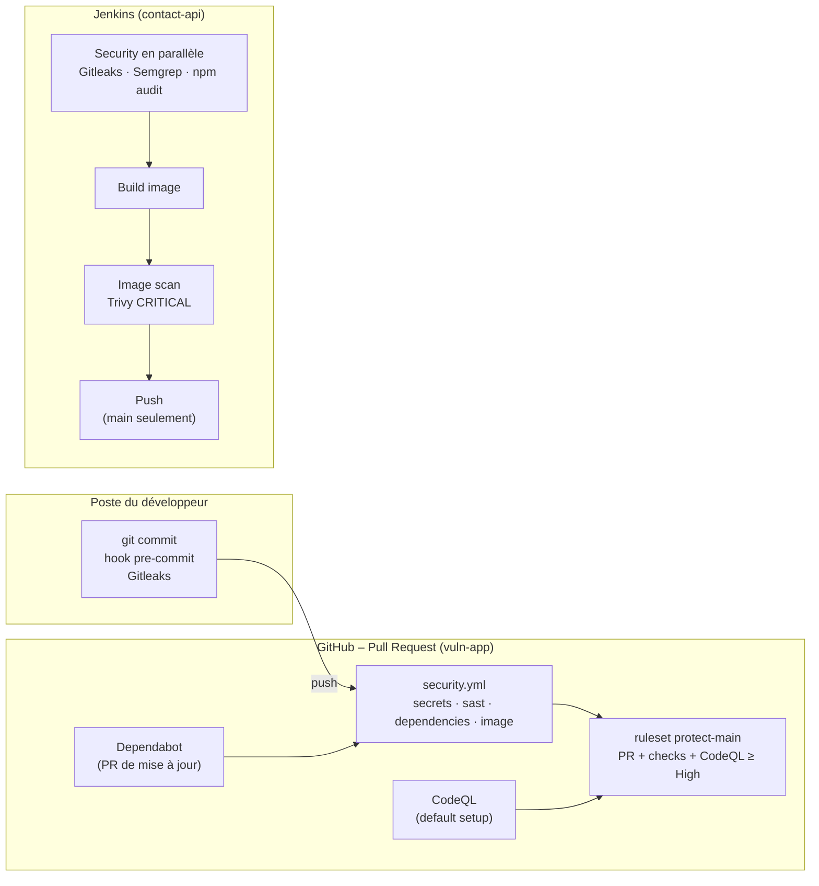

Plus un problème est trouvé tôt, moins il coûte : un secret bloqué par le hook n'est **jamais** entré dans l'historique ; une faille bloquée dans la PR n'arrive jamais sur `main` ; une image vulnérable bloquée par Jenkins n'est jamais publiée.

---

## 3. Partie 1 – Secrets dans l'historique (Gitleaks)

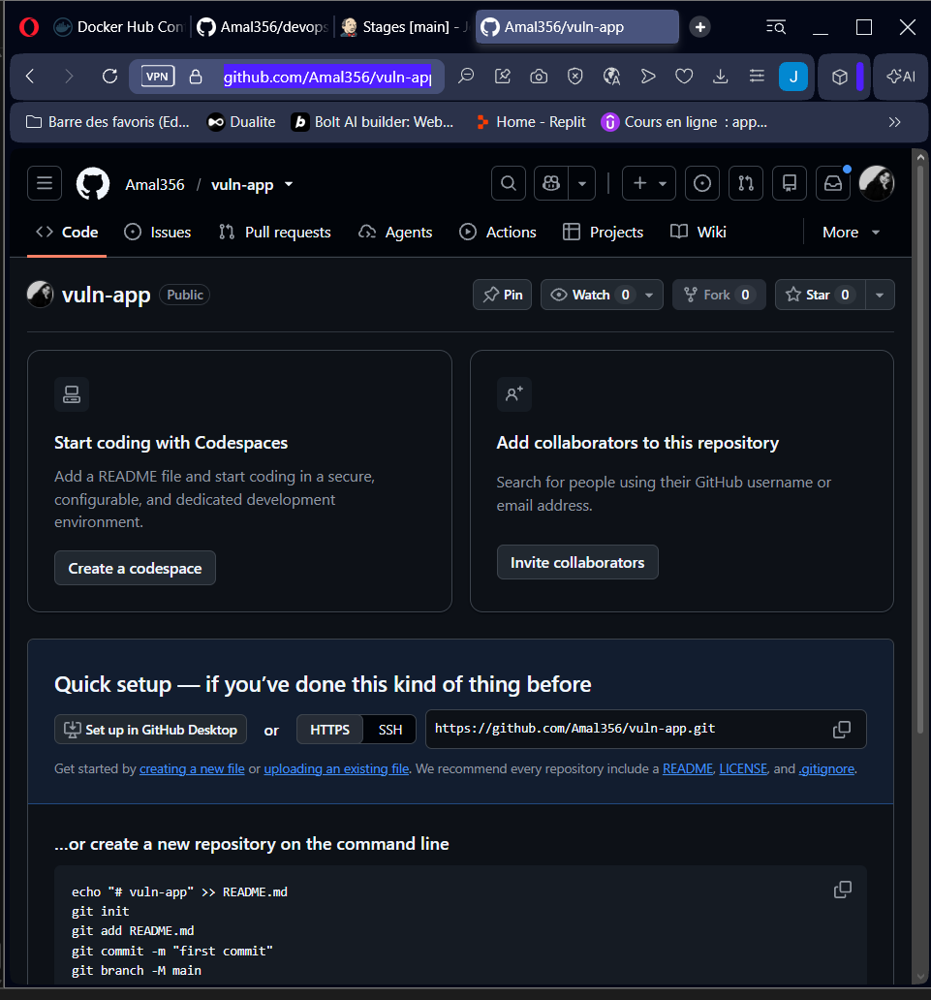

L'application de départ contenait trois secrets « en dur » : `jwt_secret` et `payment_api_key` dans `src/config.js`, `db_password` dans `config.js` **et** dans le `Dockerfile` (`ENV DB_PASSWORD=…`).

Gitleaks analyse **tout l'historique Git** (pas seulement les fichiers actuels), en conteneur :

```bash
docker run --rm -u "$(id -u):$(id -g)" -v "$PWD:/repo" \
  ghcr.io/gitleaks/gitleaks:v8.30.1 git /repo --verbose --redact
```

> `-u "$(id -u):$(id -g)"` : sans cela, Git refuse le dépôt monté (*dubious ownership*), car il appartient à un autre utilisateur que celui du conteneur.

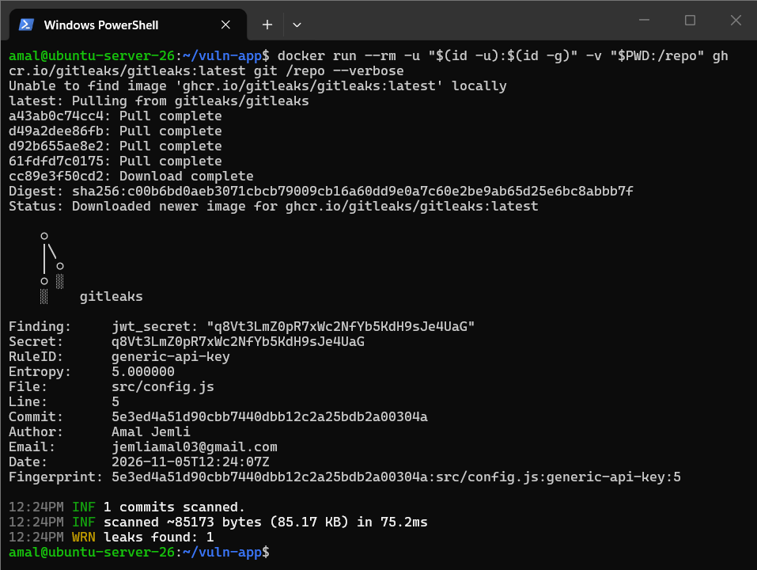

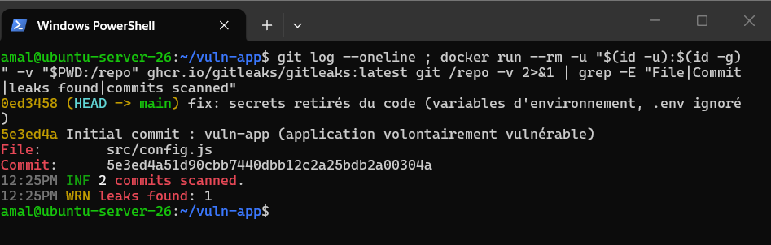

| Secret | Où | Détecté ? | Pourquoi |
|---|---|---|---|
| `jwt_secret` | `src/config.js` ligne 5, commit `5e3ed4a` | ✅ `generic-api-key` (entropie 5,0) | longue chaîne aléatoire, nom de variable évocateur |
| `payment_api_key` (`pk_lab_…`) | `src/config.js` | ❌ | préfixe inconnu des règles (≠ `sk_live_` de Stripe), entropie trop faible |
| `db_password` | `src/config.js` | ❌ | mot de passe lisible, entropie trop faible |
| `ENV DB_PASSWORD` | `Dockerfile` | ❌ | même raison |

**Leçon :** un scanner de secrets ne trouve que ce que ses règles connaissent. **1 secret sur 4** a été trouvé : « 0 leak » ne prouve pas l'absence de secret. Il faut aussi des règles de revue et, surtout, ne jamais mettre de secret dans le code.

**Correction**

- `src/config.js` lit les valeurs dans l'environnement et **échoue au démarrage** si une variable manque :

  ```js
  function required(name) {
    const value = process.env[name];
    if (!value) throw new Error(`Variable d'environnement manquante : ${name}`);
    return value;
  }
  module.exports = {
    port: Number(process.env.PORT ?? 3000),
    jwt_secret: required("JWT_SECRET"),
    payment_api_key: required("PAYMENT_API_KEY"),
    db_password: required("DB_PASSWORD"),
  };
  ```

- `.env.example` (noms des variables, sans valeurs) est versionné ; `.env` est dans `.gitignore` et `.dockerignore` ;
- `ENV DB_PASSWORD` est retiré du `Dockerfile` (les secrets sont fournis au lancement : `docker run --env-file .env`) ;
- supprimer le secret dans un nouveau commit **ne suffit pas** : il reste dans l'historique. Comme le dépôt n'avait encore jamais été poussé, l'historique a été **recréé** (premier commit propre). Sur un dépôt déjà publié, il faudrait **révoquer** le secret (le considérer comme compromis), puis réécrire l'historique (`git filter-repo`) ;
- `.gitleaksignore` est **vide** : aucun secret n'est « ignoré ».

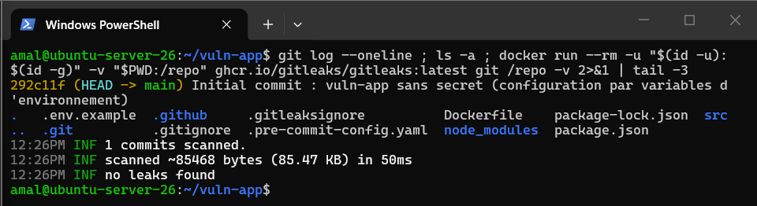

---

## 4. Partie 2 – Hook pre-commit

Le hook lance Gitleaks **avant chaque commit** : le secret ne quitte jamais le poste.

```yaml
# .pre-commit-config.yaml
repos:
  - repo: https://github.com/gitleaks/gitleaks
    rev: v8.30.0
    hooks:
      - id: gitleaks
```

```bash
pipx install pre-commit
pre-commit autoupdate      # Gitleaks v8.24.0 -> v8.30.0
pre-commit install         # crée .git/hooks/pre-commit
```

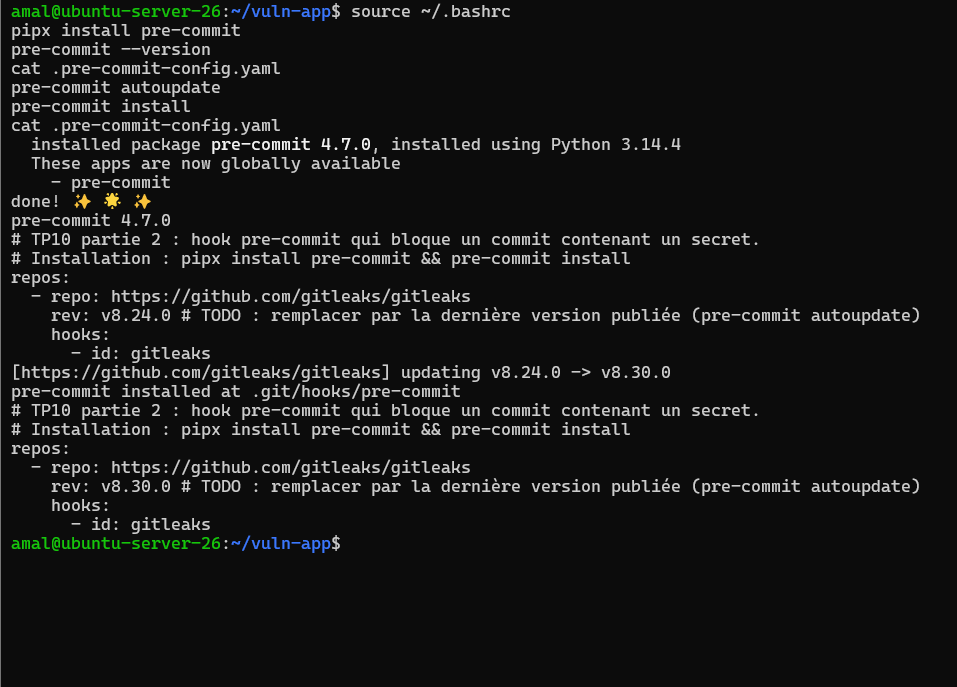

Test avec un faux jeton GitHub (`ghp_…`) :

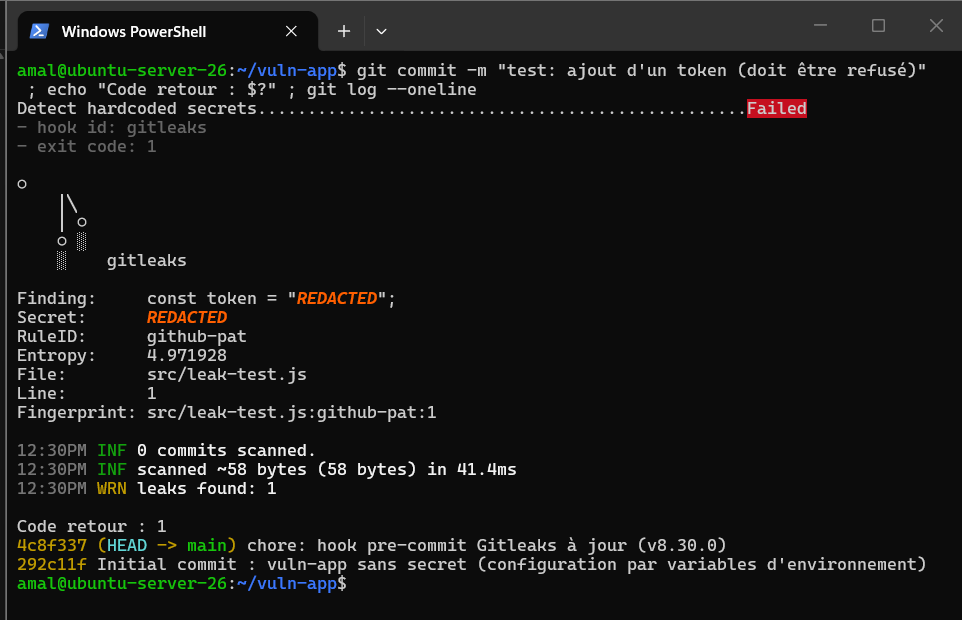

`Detect hardcoded secrets … Failed`, règle `github-pat`, code retour **1** : **aucun commit n'est créé**.

> Limite : un hook est local, il peut être contourné (`git commit --no-verify`) ou ne pas être installé. C'est pourquoi le même Gitleaks est relancé côté serveur (GitHub Actions, Jenkins) et que GitHub *push protection* est activé.

Premier push du dépôt nettoyé :

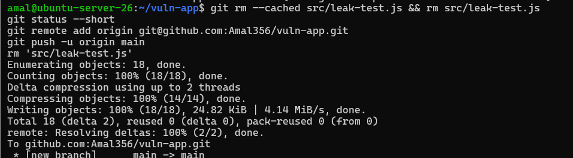

---

## 5. Partie 3 – SAST avec Semgrep

```bash
docker run --rm -v "$PWD:/src" -w /src semgrep/semgrep:1.183.0 \
  semgrep scan --config p/javascript --config p/owasp-top-ten --error src/
```

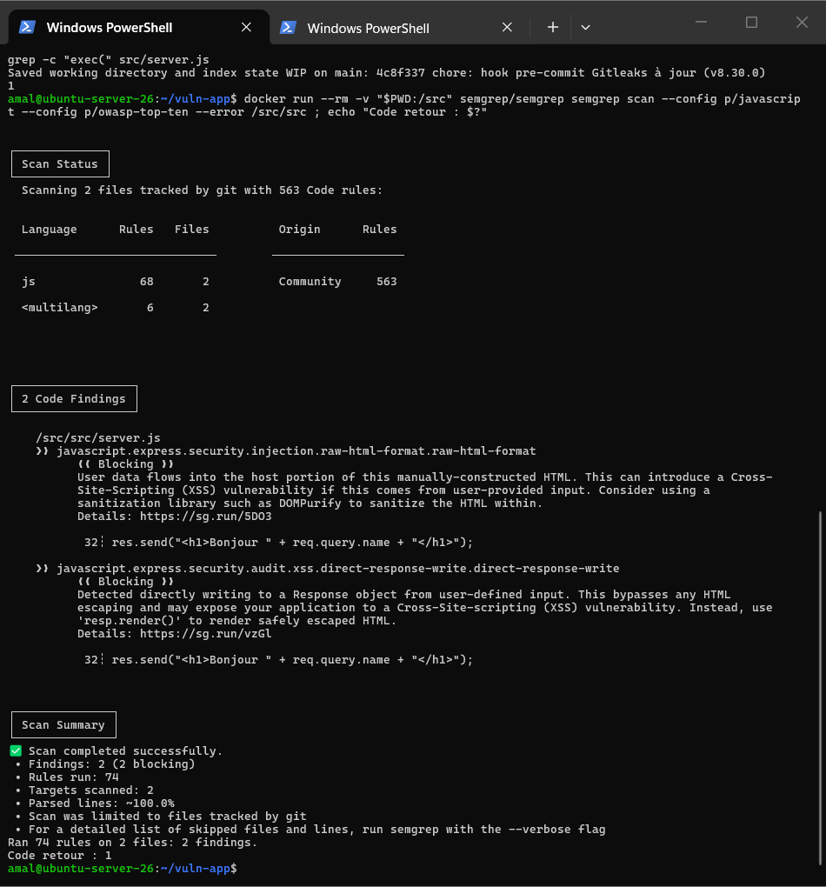

| Faille de `server.js` (version d'origine) | Détectée par Semgrep ? |
|---|---|
| XSS réfléchi `/hello` (`res.send("<h1>Bonjour " + req.query.name + …)`) | ✅ **2 findings** : `raw-html-format`, `direct-response-write` |
| Injection SQL `/users` (concaténation dans `db.all`) | ❌ |
| Injection de commande `/ping` (`exec("ping -c 1 " + host)`) | ❌ |
| JWT signé sans expiration, secret en dur | ❌ |
| Prototype pollution `/settings` (`_.merge` sur `req.body`) | ❌ (c'est un problème de **version** de lodash : vu par `npm audit`, partie 4) |

Seulement **2 findings, tous sur la même ligne**. Les règles gratuites de Semgrep reconnaissent les motifs connus d'Express (`res.send` + `req.query`) mais ne suivent pas la donnée jusqu'à `sqlite3` ou `child_process` dans ce code : c'est l'argument du tableau Semgrep / CodeQL de la partie 5.

**Corrections** (commit `052bf5c`), y compris pour les failles non détectées :

| Faille | Avant | Après |
|---|---|---|
| Injection SQL | `"… WHERE name = '" + req.query.name + "'"` | requête **paramétrée** `"… WHERE name = ?", [name]`, erreur SQL non renvoyée au client |
| Injection de commande | `exec("ping -c 1 " + host)` (shell) | `execFile("ping", ["-c", "1", host])` (pas de shell) + **liste blanche** `^[a-zA-Z0-9][a-zA-Z0-9.-]{0,252}$` |
| XSS | concaténation HTML | `escapeHtml()` + `res.type("html")` |
| Prototype pollution | `_.merge({}, req.body)` | `_.pick(req.body, ["theme", "lang"])` |
| JWT | secret en dur, pas d'expiration | secret de l'environnement, `algorithm: "HS256"`, `expiresIn: "15m"`, `user` validé |
| Divers | – | `x-powered-by` désactivé, corps JSON limité à 10 ko |

La route `/hello` échappe maintenant la valeur, mais Semgrep reconnaît toujours le motif « HTML construit avec une variable ». Le faux positif est **documenté sur la ligne même**, avec la justification :

```js
// nosemgrep: javascript.express.security.audit.xss.direct-response-write.direct-response-write
res.type("html").send(`<h1>Bonjour ${name}</h1>`); // nosemgrep: javascript.express.security.injection.raw-html-format.raw-html-format -- valeur échappée par escapeHtml()
```

> Un `nosemgrep` doit nommer **la règle précise** et dire **pourquoi** : un `nosemgrep` global masquerait aussi les futures vraies failles.

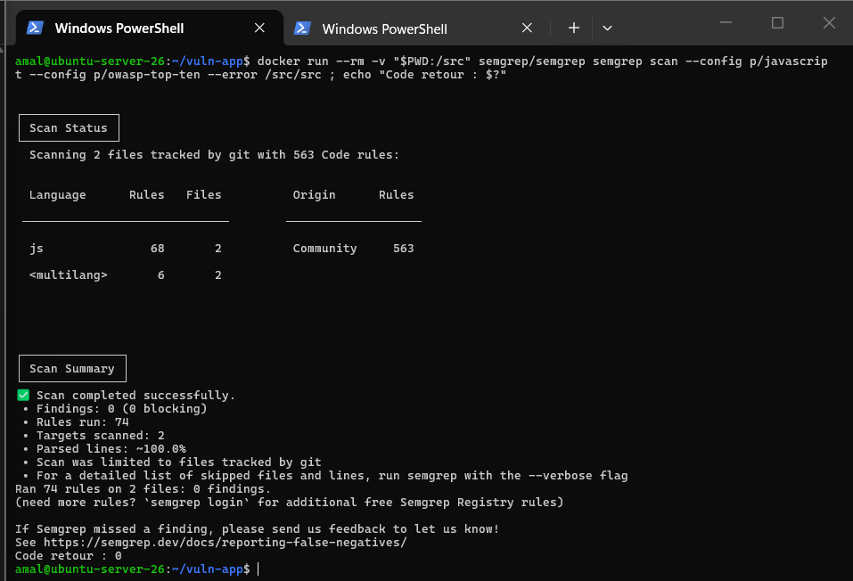

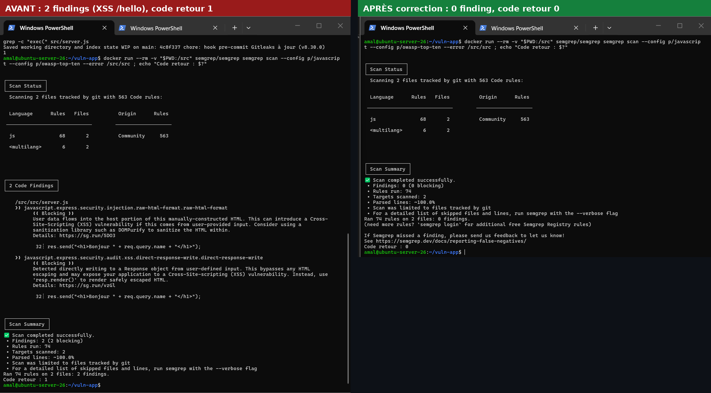

| | Avant | Après |
|---|---|---|
| Findings | 2 | **0** |
| Code retour (`--error`) | 1 | **0** |

---

## 6. Partie 4 – Dépendances (SCA) et image Docker (Trivy)

### npm audit

```bash
npm audit
```

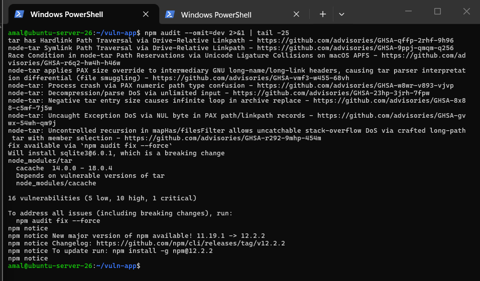

| | low | high | critical | Total |
|---|---|---|---|---|
| Avant | 5 | 10 | 1 | **16** (surtout `tar` via `sqlite3`, `lodash`) |
| Après | 0 | 0 | 0 | **0** |

Mises à jour (commit `2037e0e`) : `express@^4.21.2` (4.22.3 installée), `jsonwebtoken@^9.0.2`, `lodash@^4.17.21`, `sqlite3@^6.0.1`.

### OWASP Dependency-Check

```bash
docker run --rm -u "$(id -u):$(id -g)" \
  -v "$PWD:/src" -v "$HOME/.dependency-check:/usr/share/dependency-check/data" -v "$PWD/reports:/report" \
  owasp/dependency-check --scan /src --format HTML --out /report
```

**Échec :** `Error updating the NVD Data / No documents exist`. Depuis que la NVD limite son API, le premier téléchargement de toute la base demande une **clé d'API NVD gratuite** (`--nvdApiKey`, demande sur nvd.nist.gov). Le scan n'a donc pas pu être comparé chiffre par chiffre.

| | `npm audit` | OWASP Dependency-Check |
|---|---|---|
| Source | base GitHub Advisory (registre npm) | NVD (CPE) + autres sources |
| Démarrage | immédiat, aucune base locale | télécharge toute la NVD (clé d'API conseillée, plusieurs minutes) |
| Écosystèmes | npm uniquement | Java, .NET, JS, Python… |
| Précision | correspondance exacte paquet/version | correspondance par CPE : plus de faux positifs |
| Correctif proposé | oui (`npm audit fix`) | non |
| Usage retenu | **gate dans la CI** (rapide) | audit périodique, projets multi-langages |

### Trivy : image et Dockerfile

```bash
docker build -t vuln-app:1 .
docker run --rm -v /var/run/docker.sock:/var/run/docker.sock aquasec/trivy:0.76.2 \
  image --severity HIGH,CRITICAL vuln-app:1
docker run --rm -v "$PWD:/src" aquasec/trivy:0.76.2 config /src
```

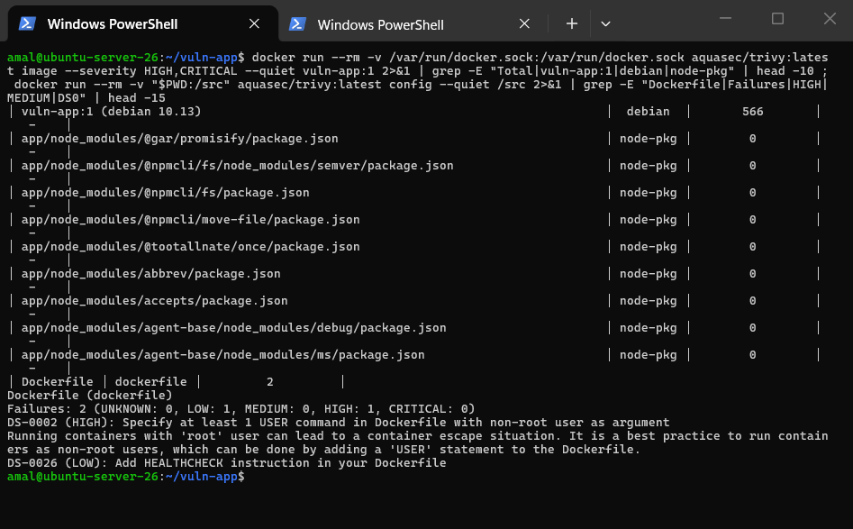

Nouveau `Dockerfile` :

```dockerfile
# syntax=docker/dockerfile:1
FROM node:24-alpine AS deps
WORKDIR /app
RUN apk add --no-cache python3 make g++          # outils de compilation de sqlite3 : étape deps seulement
COPY package.json package-lock.json ./
RUN npm ci --omit=dev

FROM node:24-alpine
ENV NODE_ENV=production
WORKDIR /app
COPY --from=deps --chown=node:node /app/node_modules ./node_modules
COPY --chown=node:node package.json ./
COPY --chown=node:node src ./src
USER node
EXPOSE 3000
HEALTHCHECK --interval=30s --timeout=3s --retries=3 \
  CMD wget -qO- "http://localhost:3000/hello?name=healthcheck" || exit 1
CMD ["node", "src/server.js"]
```

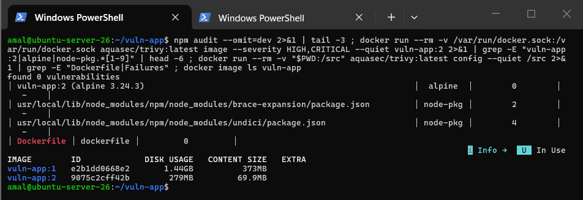

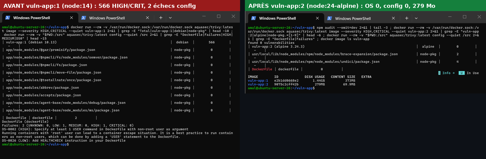

| | `vuln-app:1` (avant) | `vuln-app:2` (après) |
|---|---|---|
| Image de base | `node:14` (Debian 10.13, fin de support) | `node:24-alpine`, multi-stage |
| Taille | 1,44 Go | **279 Mo** |
| Vulnérabilités OS HIGH/CRITICAL | **566** | **0** |
| Configuration (Trivy config) | DS-0002 *root* (HIGH), DS-0026 pas de `HEALTHCHECK` (LOW) | **0** |
| Utilisateur | root | `node` |
| Secret dans l'image | `ENV DB_PASSWORD` | aucun (`--env-file` au lancement) |

Il reste **6 HIGH** dans le `npm` **livré avec l'image** `node` (`undici`, `brace-expansion`), pas dans l'application : on ne peut pas les corriger dans notre code. Elles disparaîtront avec une nouvelle image `node:24-alpine` (Dependabot surveille l'image de base) ; c'est pourquoi la CI bloque sur **CRITICAL corrigeable** (`--severity CRITICAL --ignore-unfixed`) et non sur HIGH.

---

## 7. Partie 5 – Sécurité du dépôt GitHub

### Réglages activés (*Settings → Advanced Security*)

Dependency graph, **Dependabot alerts** et **security updates**, **secret scanning** + **push protection**, **CodeQL** (*default setup*, analyse JavaScript/TypeScript et GitHub Actions).

### Workflow `security.yml`

Quatre jobs ; `image` ne se lance que si les trois premiers sont verts :

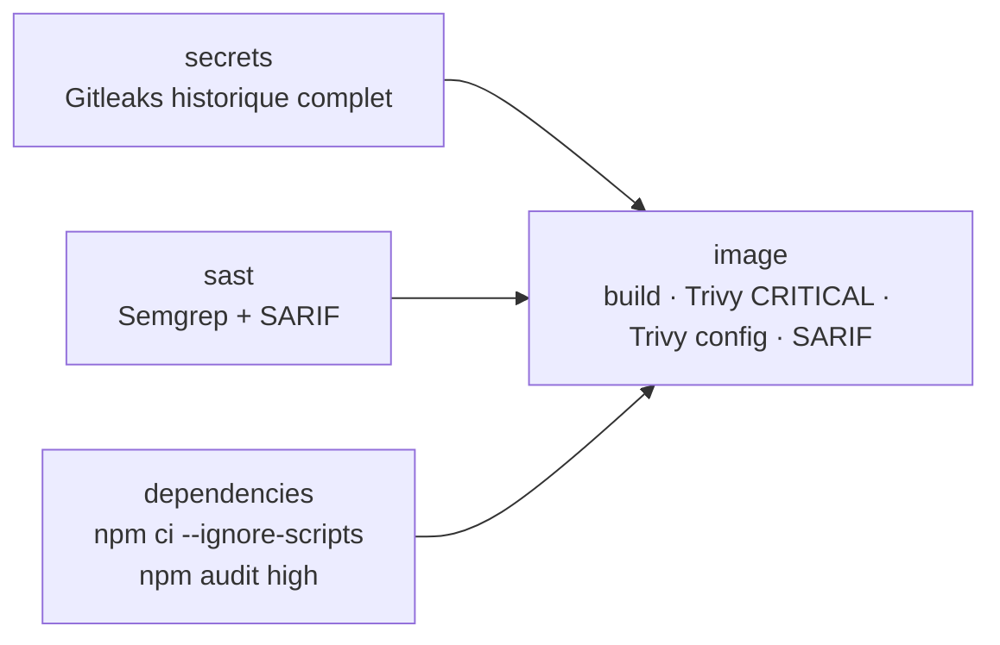

Choix de sécurité du workflow lui-même (la CI est une cible : elle a accès au code et aux jetons) :

| Choix | Pourquoi |
|---|---|
| `permissions: contents: read` au niveau global, `security-events: write` **seulement** pour `sast` et `image` | moindre privilège : un job compromis ne peut pas écrire dans le dépôt |
| Actions épinglées par **SHA complet** (`actions/checkout@3d3c42e…  # v7.0.1`) | un tag (`v7`) peut être déplacé vers du code malveillant, un SHA non |
| Images des scanners épinglées (`gitleaks:v8.30.1`, `semgrep:1.183.0`, `trivy:0.76.2`) | build reproductible, pas de `latest` |
| `fetch-depth: 0` pour Gitleaks | analyse de **tout** l'historique, pas du seul dernier commit |
| `npm ci --ignore-scripts` | aucun script `postinstall` d'une dépendance n'est exécuté pendant l'audit |
| `if: always()` sur l'envoi des SARIF | les résultats arrivent dans l'onglet *Security* **même quand le job échoue** |

Le fichier complet est dans [`vuln-app/.github/workflows/security.yml`](https://github.com/Amal356/vuln-app/blob/main/.github/workflows/security.yml) (copie en fin de section).

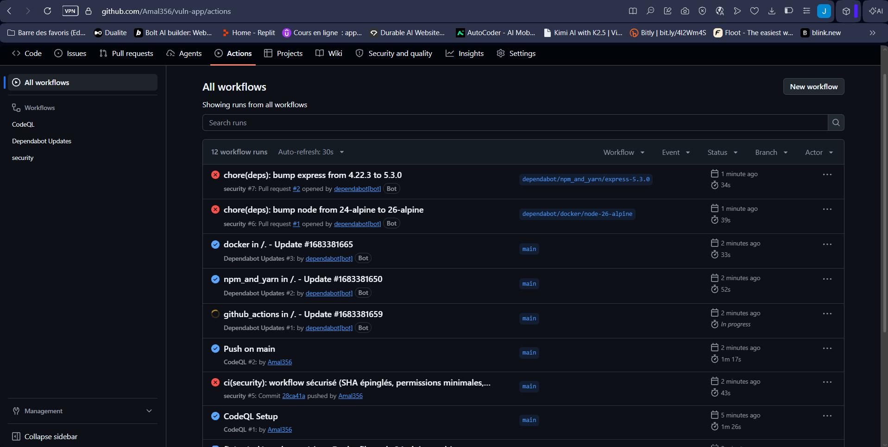

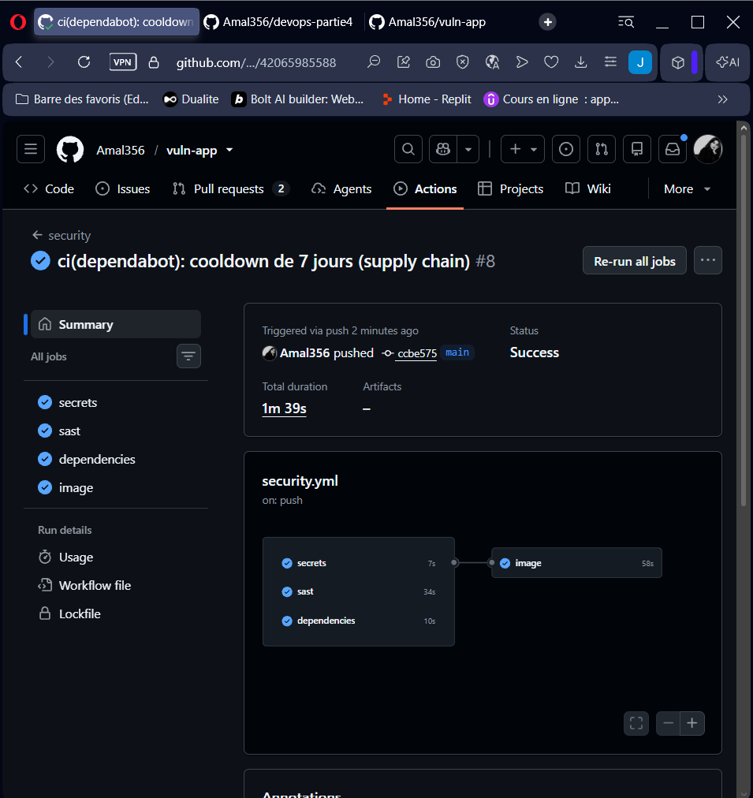

Run `security` n° 8 sur `main` : **4 jobs verts** (secrets 7 s, sast 34 s, dependencies 10 s, image 58 s).

### Dependabot

`dependabot.yml` : écosystèmes `npm`, `github-actions` et `docker`, une fois par semaine, avec un **cooldown de 7 jours** :

```yaml
cooldown:
  default-days: 7
```

Une version piégée publiée sur un registre est en général retirée en quelques jours : attendre 7 jours avant de la proposer réduit le risque d'attaque de la chaîne d'approvisionnement. C'est d'ailleurs **Semgrep** qui l'a signalé (`dependabot-missing-cooldown` × 3, job `sast` rouge) : le scanner analyse aussi la configuration de la CI.

Dependabot a ouvert deux PR :

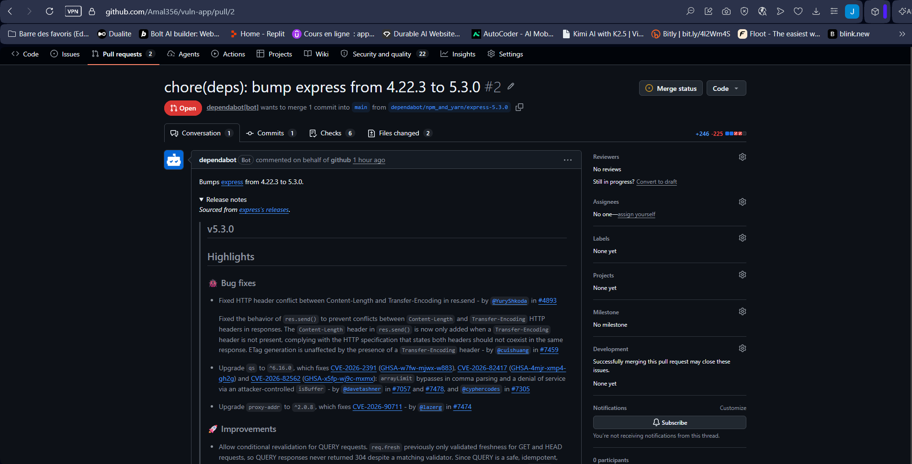

| PR | Changement | Décision |
|---|---|---|
| #1 | `node` 24-alpine → 26-alpine | **non fusionnée** |
| #2 | `express` 4.22.3 → 5.3.0 | **non fusionnée** |

Ce sont des **versions majeures** (changements incompatibles possibles, Express 5 modifie le routage) : une mise à jour majeure se teste et se planifie, elle ne se fusionne pas automatiquement.

### Code scanning

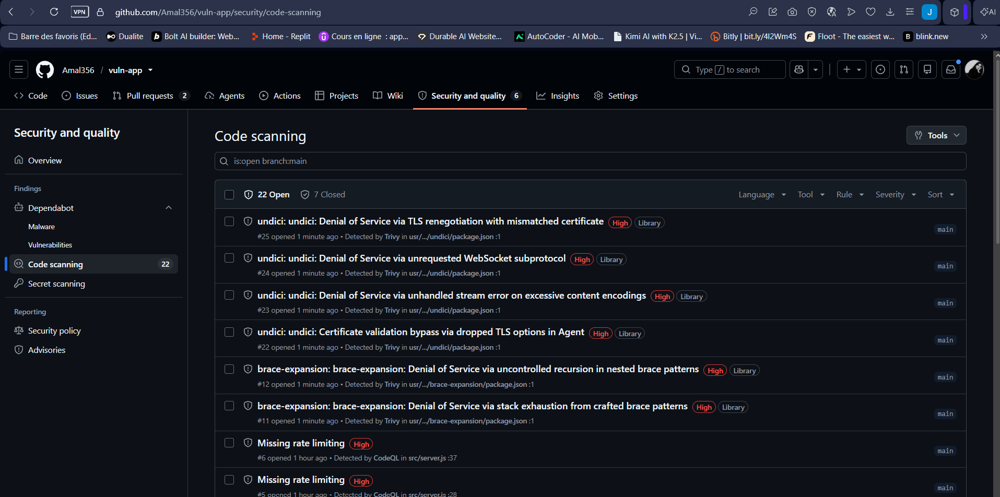

**22 alertes ouvertes** sur `main` (7 fermées après corrections) :
- **Trivy** : `undici` et `brace-expansion` dans le `npm` de l'image `node` (voir partie 4) ;
- **CodeQL** : `Missing rate limiting` (High), `server.js` lignes 28 et 37 : `/users` accède à la base et `/ping` lance une commande **sans limite de débit** (déni de service, force brute). Aucun outil précédent ne l'avait signalé. La correction serait un `express-rate-limit`, comme dans `contact-api` (TP8).

### Ruleset `protect-main`

*Settings → Rules → Rulesets → New branch ruleset* : actif, cible la branche par défaut, **liste de contournement vide** (même l'administratrice ne peut pas passer outre).

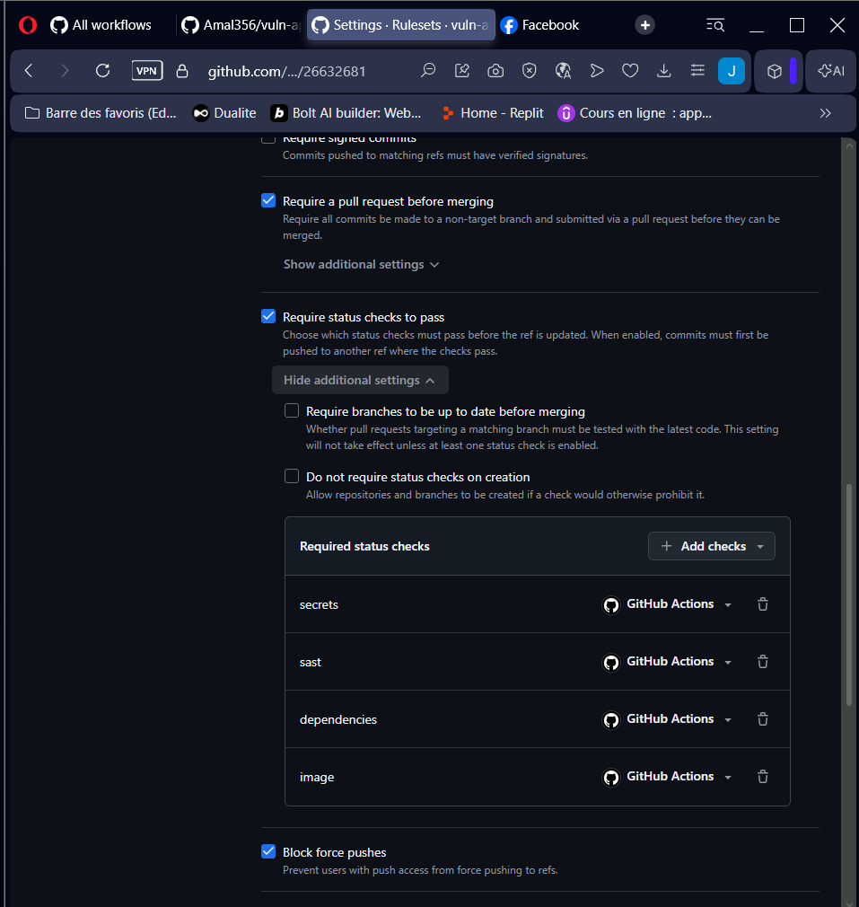

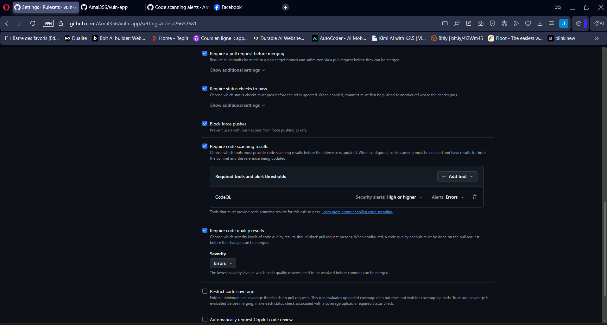

| Règle | Effet |
|---|---|
| Restrict deletions / Block force pushes | `main` ne peut être ni supprimée ni réécrite |
| Require a pull request (1 approbation) | aucun push direct sur `main` |
| Require status checks : `secrets`, `sast`, `dependencies`, `image` | les 4 jobs de `security.yml` doivent être verts |
| Require code scanning results : **CodeQL**, alertes de sécurité **High or higher**, alertes **Errors** | une nouvelle faille High détectée par CodeQL bloque la fusion |
| Require code quality results : Errors | idem pour la qualité de code |

### PR qui réintroduit une injection SQL

```bash
cd ~/vuln-app && git checkout -b test/sqli-regression
sed -i "s|\"SELECT id, name FROM users WHERE name = ?\", \[name\], |\"SELECT id, name FROM users WHERE name = '\" + name + \"'\", |" src/server.js
git commit -am "test: réintroduit une injection SQL (doit être bloquée)" && git push -u origin test/sqli-regression
```

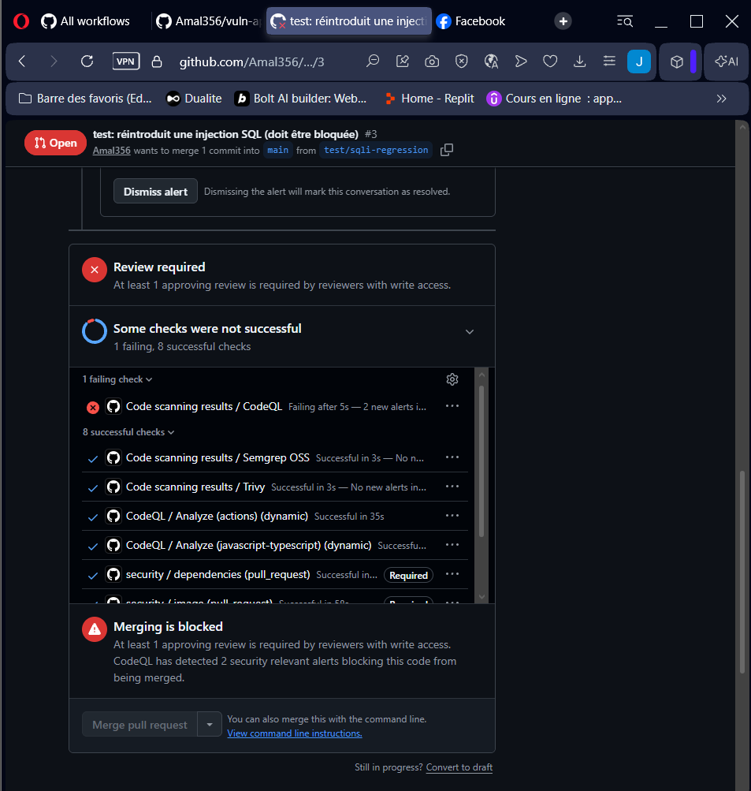

PR #3 : **Merging is blocked**. *Review required* + `Code scanning results / CodeQL` en échec (*2 new alerts*). Les 8 autres checks sont verts, **y compris Semgrep OSS**.

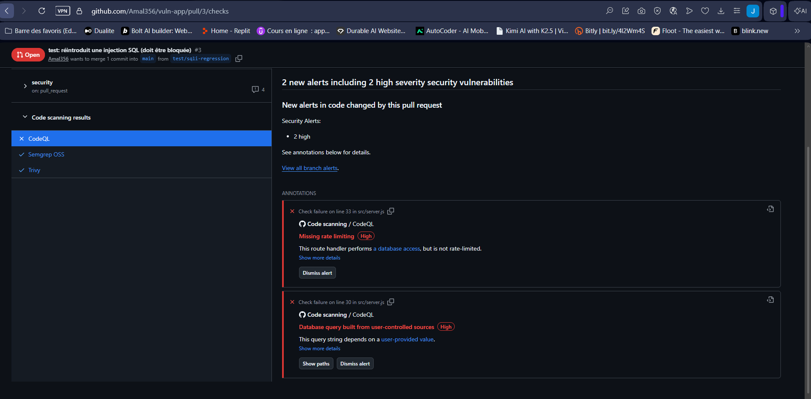

CodeQL signale **2 nouvelles alertes High** dans le code modifié : `Database query built from user-controlled sources` (`server.js:30`, l'injection SQL) et `Missing rate limiting` (`server.js:33`). La PR reste ouverte, **non fusionnée** : c'est la preuve que le gate fonctionne.

### Semgrep ou CodeQL ?

| Faille | Semgrep (`p/javascript` + `p/owasp-top-ten`) | CodeQL (default setup) |
|---|---|---|
| XSS réfléchi `/hello` | ✅ 2 règles | non mesuré (corrigé avant l'activation de CodeQL) |
| Injection SQL `/users` | ❌ partie 3, ❌ PR #3 (*No new alerts*) | ✅ `js/sql-injection`, High, **bloque la PR** |
| Injection de commande `/ping` | ❌ | non mesuré (corrigé avant l'activation) |
| JWT sans expiration | ❌ | non mesuré |
| Absence de rate limiting | ❌ | ✅ `js/missing-rate-limiting` × 2 |
| Configuration CI (`dependabot.yml` sans cooldown) | ✅ `dependabot-missing-cooldown` | ❌ (n'analyse pas ce fichier) |
| Vitesse | quelques secondes, en local ou en CI | ~35 s, dans GitHub (compile une base de données du code) |
| Méthode | **motifs** syntaxiques (règles lisibles, faciles à écrire) | **flux de données** (*taint tracking*) source → puits, inter-procédural |

**Conclusion :** les deux sont complémentaires. Semgrep est rapide, tourne partout (pre-commit, Jenkins) et accepte des règles maison ; CodeQL suit la donnée de `req.query` jusqu'à la requête SQL et trouve ce que les motifs simples ratent. Dans ce TP, **la faille la plus grave (injection SQL) n'a été bloquée que par CodeQL**.

### `security.yml` complet

```yaml
name: security

on:
  pull_request:
  push:
    branches: [main]

permissions:
  contents: read

jobs:
  secrets:
    runs-on: ubuntu-latest
    steps:
      - uses: actions/checkout@3d3c42e5aac5ba805825da76410c181273ba90b1 # v7.0.1
        with:
          fetch-depth: 0 # historique complet : Gitleaks analyse tous les commits
      - name: Gitleaks (historique complet)
        run: |
          docker run --rm -u "$(id -u):$(id -g)" -v "$PWD:/repo" \
            ghcr.io/gitleaks/gitleaks:v8.30.1 git /repo --redact --verbose

  sast:
    runs-on: ubuntu-latest
    permissions:
      contents: read
      security-events: write # publication du SARIF dans l'onglet Security
    steps:
      - uses: actions/checkout@3d3c42e5aac5ba805825da76410c181273ba90b1 # v7.0.1
      - name: Semgrep (p/javascript + p/owasp-top-ten)
        run: |
          docker run --rm -u "$(id -u):$(id -g)" -e HOME=/tmp -v "$PWD:/src" -w /src \
            semgrep/semgrep:1.183.0 semgrep scan \
            --config p/javascript --config p/owasp-top-ten \
            --sarif --output semgrep.sarif --error .
      - name: Publier le SARIF Semgrep
        if: always()
        uses: github/codeql-action/upload-sarif@33d7b85da1a04171e211befe2c739303b9a4c066 # v4.39.3
        with:
          sarif_file: semgrep.sarif
          category: semgrep

  dependencies:
    runs-on: ubuntu-latest
    steps:
      - uses: actions/checkout@3d3c42e5aac5ba805825da76410c181273ba90b1 # v7.0.1
      - name: npm ci (sans scripts d'installation)
        run: npm ci --ignore-scripts
      - name: npm audit (échec à partir de high)
        run: npm audit --audit-level=high --omit=dev

  image:
    runs-on: ubuntu-latest
    needs: [secrets, sast, dependencies]
    permissions:
      contents: read
      security-events: write
    steps:
      - uses: actions/checkout@3d3c42e5aac5ba805825da76410c181273ba90b1 # v7.0.1
      - name: Build de l'image
        run: docker build -t vuln-app:${{ github.sha }} .
      - name: Trivy image (bloquant sur CRITICAL corrigeable)
        run: |
          docker run --rm -v /var/run/docker.sock:/var/run/docker.sock \
            aquasec/trivy:0.76.2 image --severity CRITICAL --exit-code 1 --ignore-unfixed \
            vuln-app:${{ github.sha }}
      - name: Trivy config (Dockerfile)
        run: |
          docker run --rm -v "$PWD:/src" aquasec/trivy:0.76.2 config \
            --severity HIGH,CRITICAL --exit-code 1 /src
      - name: Trivy image (rapport SARIF complet)
        if: always()
        run: |
          docker run --rm -v /var/run/docker.sock:/var/run/docker.sock -v "$PWD:/out" \
            aquasec/trivy:0.76.2 image --format sarif --output /out/trivy.sarif vuln-app:${{ github.sha }}
      - name: Publier le SARIF Trivy
        if: always()
        uses: github/codeql-action/upload-sarif@33d7b85da1a04171e211befe2c739303b9a4c066 # v4.39.3
        with:
          sarif_file: trivy.sarif
          category: trivy
```

---

## 8. Partie 6 – Quality gates de sécurité dans Jenkins

On reprend le `Jenkinsfile` du TP9 (`contact-api`, job Multibranch) sur une branche `feature/security-gates`. Deux stages sont ajoutés :

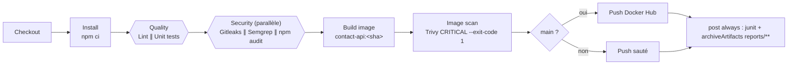

Extrait du [`Jenkinsfile`](../Jenkinsfile) :

```groovy
environment {
  IMAGE_NAME = 'amal878/contact-api'
  // Outils de sécurité : versions épinglées (supply chain)
  GITLEAKS_IMAGE = 'ghcr.io/gitleaks/gitleaks:v8.30.1'
  SEMGREP_IMAGE  = 'semgrep/semgrep:1.183.0'
  TRIVY_IMAGE    = 'aquasec/trivy:0.76.2'
}
...
// Un seul scanner qui échoue = pipeline rouge.
stage('Security') {
  parallel {
    stage('Secrets (Gitleaks)') {
      steps {
        sh '''
          docker run --rm -u "$(id -u):$(id -g)" -v "$PWD:/repo" "$GITLEAKS_IMAGE" \
            git /repo --redact --report-format json --report-path /repo/reports/gitleaks.json
        '''
      }
    }
    stage('SAST (Semgrep)') {
      steps {
        sh '''
          docker run --rm -u "$(id -u):$(id -g)" -e HOME=/tmp -v "$PWD:/src" -w /src "$SEMGREP_IMAGE" \
            semgrep scan --config p/javascript --config p/owasp-top-ten \
            --exclude node_modules --exclude reports \
            --metrics=off --error --sarif -o reports/semgrep.sarif .
        '''
      }
    }
    stage('Dependencies (npm audit)') {
      agent { docker { image 'node:24-alpine'; args '-e HOME=/tmp'; reuseNode true } }
      steps {
        // Le rapport est écrit AVANT de renvoyer le code retour (sinon un échec n'archive rien).
        sh '''
          set +e
          npm audit --omit=dev --audit-level=high > reports/npm-audit.txt 2>&1
          rc=$?
          cat reports/npm-audit.txt
          exit $rc
        '''
      }
    }
  }
}

stage('Build image') { ... }   // inchangé (TP9)

// On ne pousse jamais une image avec une vulnérabilité CRITICAL corrigeable.
stage('Image scan') {
  steps {
    sh '''
      mkdir -p "$JENKINS_HOME/.cache/trivy"
      set +e
      docker run --rm -u "$(id -u):$(id -g)" \
        --group-add "$(stat -c %g /var/run/docker.sock)" \
        -v /var/run/docker.sock:/var/run/docker.sock \
        -v "$JENKINS_HOME/.cache/trivy:/tmp/trivy" -e TRIVY_CACHE_DIR=/tmp/trivy \
        -v "$PWD/reports:/reports" \
        "$TRIVY_IMAGE" image --severity CRITICAL --ignore-unfixed --exit-code 1 \
        --format table --output /reports/trivy-image.txt "$IMAGE_NAME:$SHORT_SHA"
      rc=$?
      cat reports/trivy-image.txt
      exit $rc
    '''
  }
}
...
post {
  always {
    junit testResults: 'reports/*.xml', allowEmptyResults: true
    // rapports de sécurité archivés même si le pipeline est rouge (c'est là qu'on en a besoin)
    archiveArtifacts artifacts: 'reports/**', allowEmptyArchive: true
  }
}
```

| Choix | Pourquoi |
|---|---|
| Les 3 scanners en `parallel`, **sans `failFast`** | on obtient **les 3 rapports** même si l'un échoue (avec `failFast`, les autres étaient interrompus et leur rapport manquait) |
| `set +e` … `exit $rc` | le rapport est écrit et affiché **puis** le code retour est renvoyé : un stage rouge a quand même son rapport |
| `archiveArtifacts 'reports/**'` dans `post always` | les rapports (`gitleaks.json`, `semgrep.sarif`, `npm-audit.txt`, `trivy-image.txt`, `junit.xml`) sont téléchargeables depuis chaque build, rouge ou vert |
| `npm audit --omit=dev` | seules les dépendances **livrées dans l'image** bloquent (`npm ci` signale 10–11 vulnérabilités, toutes dans les outils de développement : vitest, esbuild…) |
| Trivy `--severity CRITICAL --ignore-unfixed` | on bloque ce qu'on **peut** corriger, pas les CVE sans correctif de l'image de base |
| Cache Trivy dans `JENKINS_HOME` | la base de vulnérabilités n'est pas retéléchargée à chaque build (temps et disque de la VM) |
| `--group-add <gid du socket>` | Trivy lit l'image via le socket Docker **sans tourner en root** |
| `Build image` **après** `Security` | une image n'est même pas construite si le code ou les dépendances sont vulnérables |

### Historique des builds de `feature/security-gates`

| Build | Commit | Résultat | Stage bloquant |
|---|---|---|---|
| #1 à #5 (5 nov.) | mise au point du `Jenkinsfile` | ❌ | #5 : **npm audit**, `zod <4.6.6` High ([GHSA-mrhx-c7xc-m3w5](https://github.com/advisories/GHSA-mrhx-c7xc-m3w5)) |
| #6, #7 | `fe30465` faille XSS volontaire (+ zod 4.6.7) | ❌ | **Semgrep**, 2 findings |
| #8 | `dceabba` *Revert* | ❌ | **npm audit** : le revert a aussi annulé la mise à jour de zod |
| #9, #10 | `fe9d0a1` *Reapply* (2e revert par erreur) | ❌ / annulé | Semgrep |
| **#11** | `8370859` faille retirée, zod 4.6.7 conservé | ✅ **SUCCESS** | – |

**Build #5 : la dépendance vulnérable bloque le pipeline.** Le code n'avait aucun problème, mais `zod` (dépendance de **production**, utilisée pour la validation depuis le TP8) avait une vulnérabilité High connue : le pipeline est passé au rouge avant même la construction de l'image. Correction : `zod` `^3.25.0` → `^4.6.7` (les 24 tests passent sans autre modification).

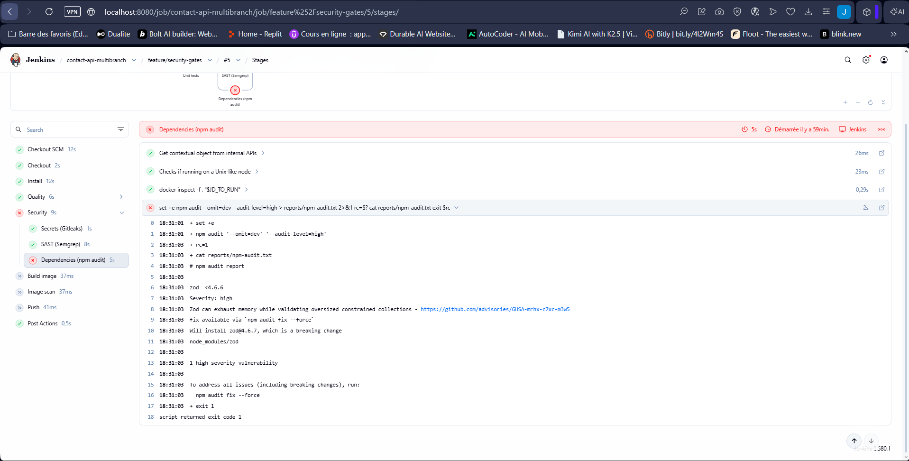

**Build #6 : faille XSS volontaire**

```bash
sed -i 's|^  // Route 404|  // TP10 : faille volontaire (XSS) pour la démo du quality gate\n  app.get("/hello", (req, res) => res.send("<h1>Bonjour " + req.query.name + "</h1>"));\n\n  // Route 404|' src/app.js
grep -n "hello" src/app.js
git commit -am "test: faille XSS volontaire (le pipeline doit être rouge)" && git push
```

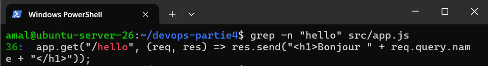

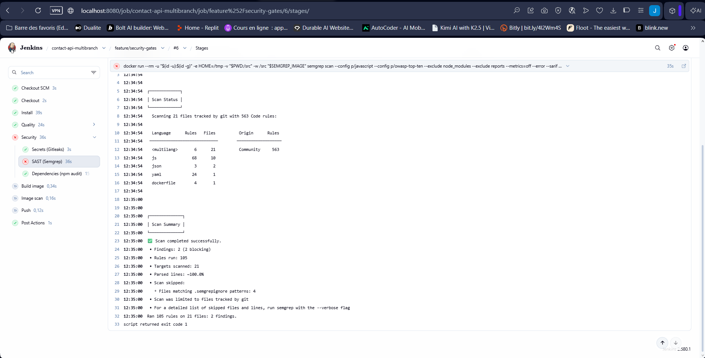

| Stage | Résultat build #6 |
|---|---|
| Secrets (Gitleaks) | ✅ 10 commits, `no leaks found` |
| **SAST (Semgrep)** | ❌ `Findings: 2 (2 blocking)` : `raw-html-format` et `direct-response-write`, `src/app.js:36` |
| Dependencies (npm audit) | ✅ `found 0 vulnerabilities` |
| Build image, Image scan, Push | ⏭ *skipped due to earlier failure(s)* : **l'image vulnérable n'est jamais construite** |
| Rapports | archivés (`semgrep.sarif` lu pour obtenir le nom des règles) |

**Build #11 : faille retirée, tout est vert**

```bash
git checkout 92f6dea -- src/app.js        # version sans la faille, zod 4.6.7 conservé
git commit -m "fix: retire la faille XSS de démonstration (zod 4.6.7 conservé)" && git push
```

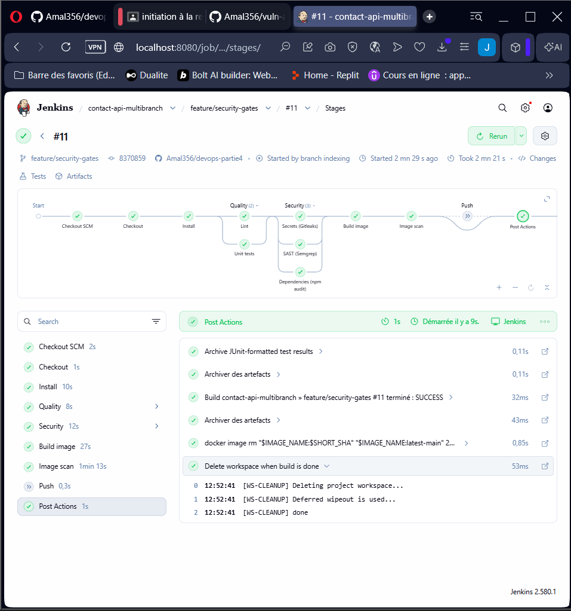

Trivy sur `amal878/contact-api:8370859` : **0** vulnérabilité CRITICAL dans l'OS (Alpine 3.24.4) et **0** dans les 230 paquets Node de l'image. `Push` est sauté : on est sur une branche, pas sur `main`.

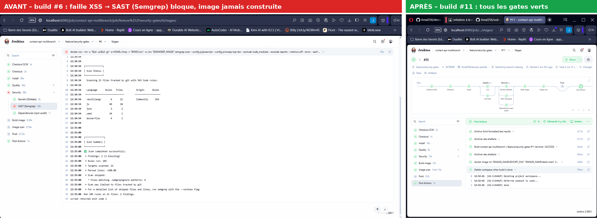

La branche est ensuite fusionnée dans `main` en un seul commit (*squash*) : le build de `main` passe les mêmes gates **puis** publie l'image.

> Le message `Could not update commit status … 403` dans chaque console est **attendu** : le jeton GitHub de Jenkins est en **lecture seule**, il ne peut pas écrire de statut dans GitHub (moindre privilège, voir TP9).

---

## 9. Réponses aux questions

**Pourquoi « shift left » ?** Une faille corrigée sur le poste du développeur coûte quelques minutes ; en production, elle coûte un incident, une réécriture d'historique, une révocation de secrets. Chaque couche de ce TP arrête le problème **avant** l'étape suivante.

**Pourquoi plusieurs outils ?** Chacun voit une partie du risque : Gitleaks les secrets (1 sur 4 seulement !), Semgrep les motifs de code et la configuration CI, CodeQL les flux de données (injection SQL), `npm audit` les dépendances, Trivy l'OS de l'image et le `Dockerfile`. Aucun ne suffit seul.

**Quelle sévérité doit bloquer ?** Bloquer trop (toutes les LOW, les CVE sans correctif) rend la CI rouge en permanence et pousse à désactiver les contrôles. Ici : `npm audit` **high**, Trivy **CRITICAL corrigeable**, CodeQL **High or higher** ; le reste est visible dans les rapports et l'onglet *Security*.

**Ignorer une CVE ou accepter un risque ?** *Ignorer* (`.trivyignore`, `nosemgrep`, *Dismiss alert*) cache le résultat. *Accepter un risque* est une **décision tracée** : qui, pourquoi (ex. « fonction vulnérable jamais appelée »), jusqu'à quand. Un `.trivyignore` correct contient donc une **justification et une date d'expiration** ; passé cette date, la CVE bloque à nouveau. Dans ce TP, le seul contournement est le `nosemgrep` de `/hello`, limité à deux règles précises et justifié sur la ligne.

**Pourquoi épingler les versions (SHA d'action, tag d'image) ?** Pour qu'une attaque sur un outil de la CI (tag déplacé, image `latest` piégée) ne s'exécute pas automatiquement chez nous. Dependabot propose ensuite les mises à jour, avec un cooldown de 7 jours.

**Un pipeline vert veut-il dire « sécurisé » ?** Non : il veut dire « aucun problème **connu des outils** au-dessus du seuil choisi ». Les secrets non détectés (partie 1), l'injection SQL invisible pour Semgrep (partie 3) et l'absence de rate limiting trouvée seulement par CodeQL (partie 5) le montrent.

---

## 10. Livrables

| Fichier | Contenu | |
|---|---|---|
| `gitleaks.png` | secret `generic-api-key` trouvé dans l'historique | ✅ |
| `pre-commit-blocked.png` | commit d'un faux `ghp_…` refusé par le hook | ✅ |
| `semgrep-before-after.png` | 2 findings → 0 | ✅ |
| `trivy-before-after.png` | 566 HIGH/CRITICAL, 1,44 Go → 0, 279 Mo | ✅ |
| `dependabot-pr.png` | PR #2 `express` ouverte par `dependabot[bot]` | ✅ |
| `codeql-alerts.png` | alertes code scanning (CodeQL + Trivy) | ✅ |
| `pr-blocked.png` | PR #3 injection SQL : *Merging is blocked* | ✅ |
| `jenkins-security.png` | pipeline Jenkins rouge (Semgrep) puis vert | ✅ |
| Code corrigé, `.pre-commit-config.yaml`, `security.yml`, `dependabot.yml`, `Dockerfile` | dépôt [`vuln-app`](https://github.com/Amal356/vuln-app) | ✅ |
| `Jenkinsfile` avec `Security` et `Image scan` | [`../Jenkinsfile`](../Jenkinsfile) | ✅ |
| Tableaux Gitleaks, Semgrep, Semgrep/CodeQL, npm audit/Dependency-Check, Trivy | sections 3 à 7 | ✅ |

> **Défis non réalisés (facultatifs).** Une règle Semgrep maison interdisant `console.log(req.body)` (fuite de données personnelles dans les logs) s'écrirait en quelques lignes YAML (`pattern: console.log($REQ.body)`) et s'ajouterait au stage Semgrep avec `--config .semgrep/`. Le `.trivyignore` avec date d'expiration est expliqué en section 9.

---

## 11. Difficultés rencontrées

| Problème | Cause | Solution |
|---|---|---|
| Gitleaks : *dubious ownership* | dépôt monté appartenant à un autre UID que le conteneur | `-u "$(id -u):$(id -g)"` |
| Secret toujours détecté après correction | il restait dans l'**historique** | historique recréé (dépôt jamais publié) ; sinon révocation + `git filter-repo` |
| 3 secrets sur 4 non détectés | entropie trop faible, préfixe inconnu | constat documenté ; secrets sortis du code |
| Semgrep ne voit ni l'injection SQL ni l'injection de commande | règles par motifs, pas de suivi du flux jusqu'à `sqlite3`/`child_process` | corrigées quand même ; CodeQL ajouté en partie 5 |
| OWASP Dependency-Check : `Error updating the NVD Data` | API NVD limitée sans clé | clé d'API NVD gratuite nécessaire (`--nvdApiKey`) |
| Job `sast` rouge après l'ajout de `dependabot.yml` | Semgrep : `dependabot-missing-cooldown` × 3 | `cooldown: default-days: 7` |
| Jenkins : un seul rapport archivé quand un scanner échouait | `failFast` interrompait les deux autres scanners | `failFast` retiré (commit `92f6dea`) |
| Jenkins #8 rouge alors que la faille était retirée | `git commit -am` avait aussi pris la mise à jour de `zod` (non commitée) ; le revert l'a annulée | `git checkout 92f6dea -- src/app.js` : on ne retire que la faille. Pour un commit de démonstration : `git add <fichier>` plutôt que `-am` |
| Faille revenue (build #9) | `git revert HEAD` lancé deux fois : le 2e annule le 1er (*Reapply*) | vérifier `git log --oneline -3` avant de relancer une commande |
| `Could not update commit status … 403` | jeton GitHub de Jenkins en lecture seule | voulu (moindre privilège) |

## Sécurité

- **Aucun secret** dans les dépôts : configuration par variables d'environnement, `.env` ignoré par Git et Docker, `.gitleaksignore` vide, Gitleaks à trois niveaux (hook, GitHub Actions, Jenkins) + secret scanning et push protection GitHub.
- Les anciennes valeurs des secrets de `vuln-app` sont considérées comme **compromises** (`.env.example` le rappelle) : il faut en générer de nouvelles.
- Workflow GitHub à **privilèges minimaux**, actions épinglées par SHA, images d'outils épinglées, `npm ci --ignore-scripts`.
- `main` de `vuln-app` protégée par un ruleset **sans contournement** ; aucune PR de démonstration (injection SQL, Dependabot majeures) n'a été fusionnée.
- Jenkins : jetons Docker Hub et GitHub dédiés (GitHub en lecture seule), masqués dans les logs ; l'image n'est construite qu'après les contrôles et publiée **uniquement depuis `main`**.
- `vuln-app` reste une application de **laboratoire** : elle n'est publiée sur aucun registre et ne doit pas être exposée sur un réseau.
