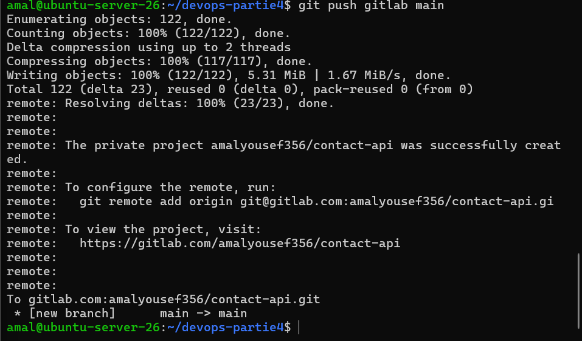
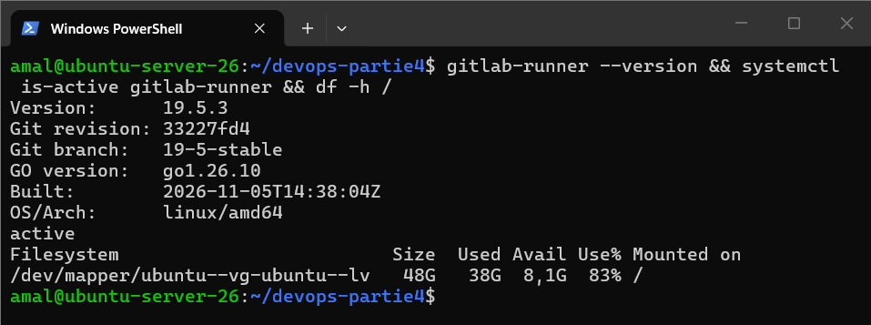
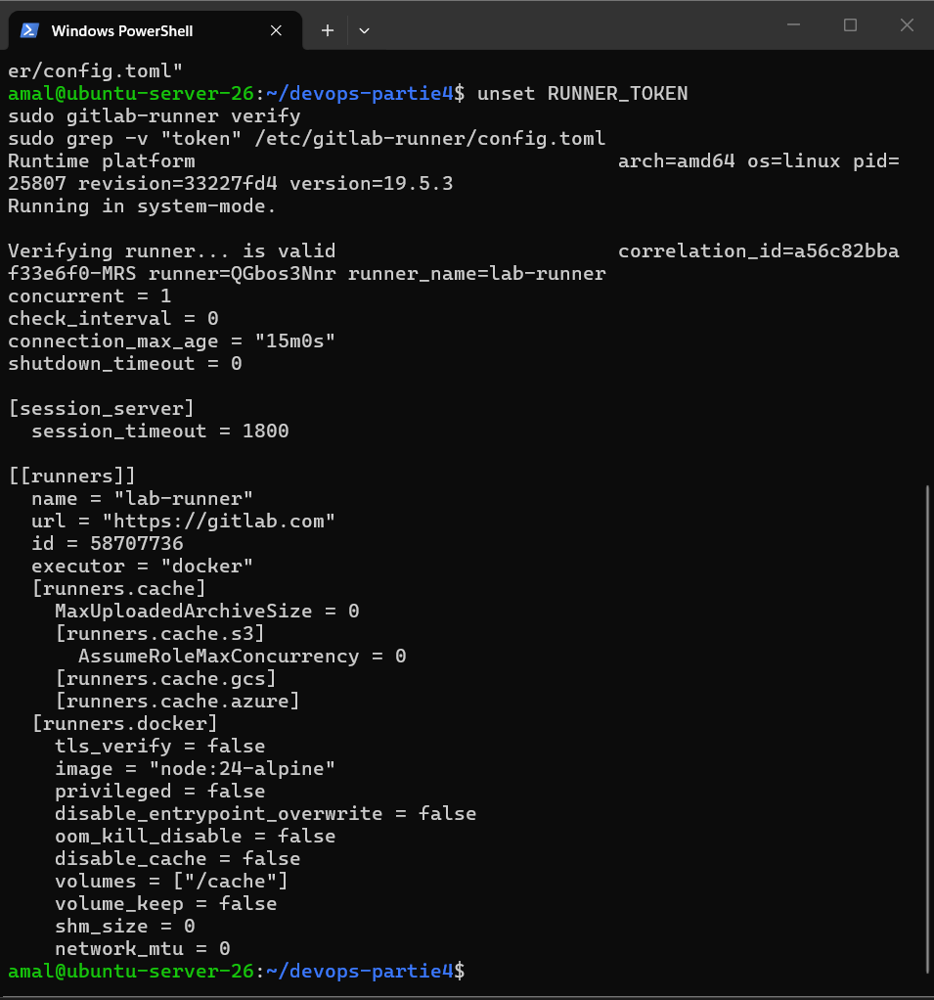
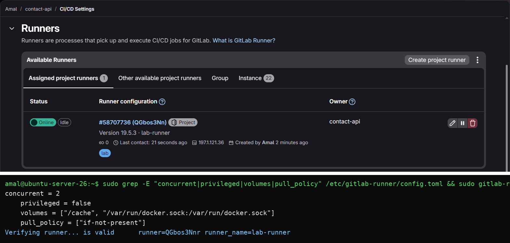
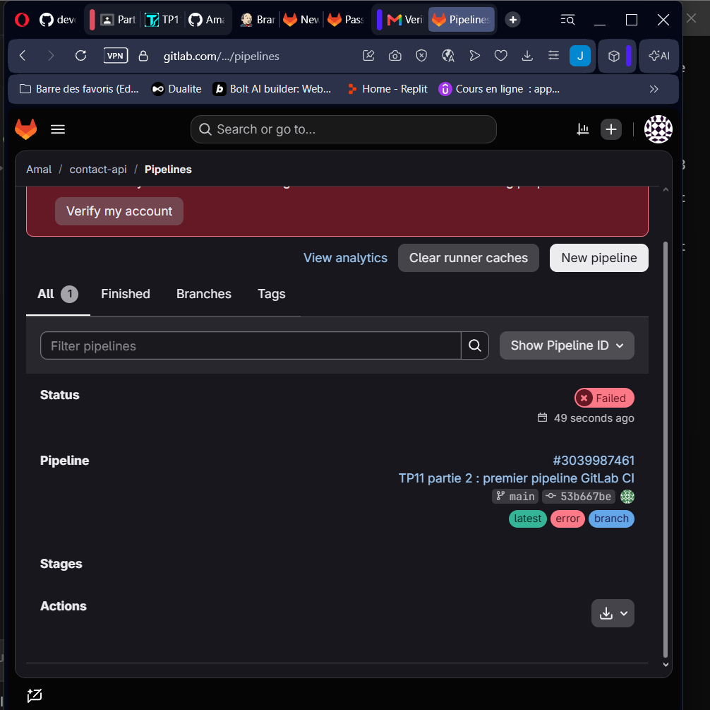
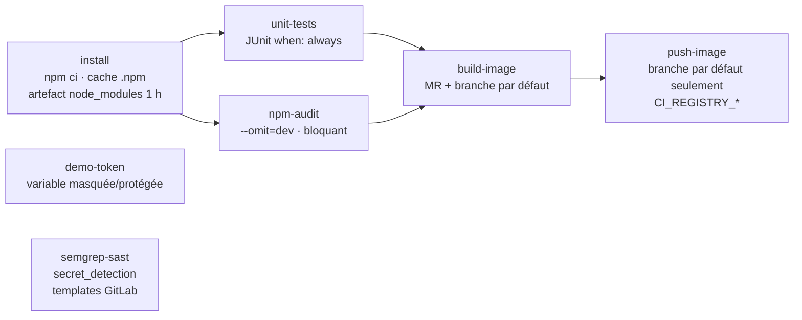

# TP11 – GitLab CI/CD et runner auto-hébergé

**Étudiante :** Amal Jemli – Master DevOps et Cloud Computing (2026/2027)
**Énoncé :** [TP11 : GitLab CI/CD et runner auto-hébergé](https://docs.teknolabs.net/courses/devops-cloud/partie-4-cicd-devsecops/tp11-gitlab-ci/)
**Projet GitLab :** [gitlab.com/amalyousef356/contact-api](https://gitlab.com/amalyousef356/contact-api) (public)

> ## ⚠️ TP partiellement réalisé
>
> La **partie 1** (runner auto-hébergé) est faite et fonctionne. Les **parties 2 à 4** n'ont pas pu être exécutées : **gitlab.com refuse de lancer le moindre pipeline** sur ce compte tant que l'identité n'est pas vérifiée, et la vérification exige, après le téléphone, une **carte bancaire**, que je n'ai pas. Contrairement à ce qu'indique l'énoncé, cette règle s'applique **même avec un runner auto-hébergé** (voir [Blocage](#3-blocage--vérification-didentité-de-gitlabcom)).
>
> Ce README contient donc : la partie 1 complète, le **`.gitlab-ci.yml` final** avec tous les TODO complétés et justifiés (écrit, non exécuté), la **comparaison des trois outils** et la **recommandation pour une PME** (partie 5), qui s'appuient sur les TP9, TP10 et sur ce que GitLab permet de constater sans pipeline.

---

## Sommaire

1. [Environnement](#1-environnement)
2. [Partie 1 – Installer et enregistrer le runner](#2-partie-1--installer-et-enregistrer-le-runner)
3. [Blocage : vérification d'identité de gitlab.com](#3-blocage--vérification-didentité-de-gitlabcom)
4. [Parties 2 à 4 – Le pipeline final (non exécuté)](#4-parties-2-à-4--le-pipeline-final-non-exécuté)
5. [Partie 5 – Comparaison Jenkins / GitHub Actions / GitLab CI/CD](#5-partie-5--comparaison-jenkins--github-actions--gitlab-cicd)
6. [Livrables](#6-livrables)
7. [Sécurité](#sécurité)

---

## 1. Environnement

| Élément | Valeur |
|---|---|
| VM de lab | `ubuntu-server-26` (Ubuntu Server 26.04.1 LTS, 3,3 Go RAM, 2 vCPU), Docker 29.8 |
| GitLab | gitlab.com, offre gratuite, projet `amalyousef356/contact-api` **public** |
| Code | `contact-api` (TP8) poussé depuis le dépôt GitHub avec un **2e remote** : `origin` = GitHub, `gitlab` = GitLab |
| Runners | runners d'instance (partagés) **désactivés** : seul notre runner peut exécuter les jobs |

```bash
ssh -T git@gitlab.com                   # clé SSH de la VM ajoutée au compte GitLab
git remote add gitlab git@gitlab.com:amalyousef356/contact-api.git
git push gitlab main                    # le projet est créé à la volée par le push
```



---

## 2. Partie 1 – Installer et enregistrer le runner

```bash
curl -fsSL "https://packages.gitlab.com/install/repositories/runner/gitlab-runner/script.deb.sh" -o /tmp/runner-repo.sh
sudo os=ubuntu dist=noble bash /tmp/runner-repo.sh      # pas encore de paquet 26.04 : paquet noble (24.04)
sudo apt install -y gitlab-runner
sudo usermod -aG docker gitlab-runner
gitlab-runner --version                                 # 19.5.3
```

> Le script est téléchargé dans un fichier **puis** exécuté (et non `curl … | sudo bash`) : on peut le relire avant de lui donner les droits root.



Projet → *Settings → CI/CD → Runners → New project runner* : tag **`lab`**, **Run untagged jobs** coché (les jobs des templates de sécurité n'ont pas de tag), description `lab-runner`. Enregistrement **sans que le jeton apparaisse** à l'écran ni dans l'historique :

```bash
read -rsp "Jeton glrt : " RUNNER_TOKEN; echo
sudo gitlab-runner register --non-interactive --url https://gitlab.com \
  --token "$RUNNER_TOKEN" --executor docker --docker-image node:24-alpine --description lab-runner
unset RUNNER_TOKEN
sudo gitlab-runner verify               # Verifying runner... is valid
sudo grep -v token /etc/gitlab-runner/config.toml    # affichage sans le jeton
```



### `config.toml` comparé à `runner-config.toml.example`

| Réglage | Après `register` | Exemple / final | Pourquoi |
|---|---|---|---|
| `concurrent` | 1 | **2** | `unit-tests` et `npm-audit` peuvent tourner en parallèle (VM : 2 vCPU) |
| `privileged` | `false` | **`false`** | jamais `true` sans raison : un conteneur privilégié a tous les droits du noyau |
| `volumes` | `["/cache"]` | **`["/cache", "/var/run/docker.sock:/var/run/docker.sock"]`** | permet `docker build` dans les jobs `build-image` / `push-image` |
| `pull_policy` | (absent) | **`["if-not-present"]`** | une image déjà présente n'est pas retéléchargée (temps, disque) |

```bash
sudo cp /etc/gitlab-runner/config.toml /etc/gitlab-runner/config.toml.bak
sudo sed -i 's|^concurrent = 1|concurrent = 2|' /etc/gitlab-runner/config.toml
sudo sed -i 's|volumes = \["/cache"\]|volumes = ["/cache", "/var/run/docker.sock:/var/run/docker.sock"]\n    pull_policy = ["if-not-present"]|' /etc/gitlab-runner/config.toml
sudo systemctl restart gitlab-runner
```



`lab-runner` : **Online**, version 19.5.3, tag `lab`, rattaché au projet `contact-api`.

**Quel risque prend-on avec le socket Docker ?** Monter `/var/run/docker.sock` donne au job le **contrôle du démon Docker de la VM**. Un job peut lancer `docker run --privileged -v /:/host …` et devenir **root sur la VM** : lire `/etc/gitlab-runner/config.toml` (le jeton du runner), les autres projets, les identifiants de Jenkins… Toute personne capable de pousser un `.gitlab-ci.yml` dans le projet devient donc root sur la VM. Acceptable dans un lab dédié ; en production on construit les images **sans privilège** (BuildKit rootless, Buildah, Kaniko : défi du TP) et l'on isole les runners (une VM ou un namespace Kubernetes par projet).

**Pourquoi aucun port n'a-t-il dû être ouvert sur la VM ?** Le runner fonctionne en **mode pull** : c'est **lui** qui interroge gitlab.com toutes les quelques secondes en **HTTPS sortant** (« y a-t-il un job pour moi ? »), télécharge le job, l'exécute et renvoie logs et artefacts. GitLab ne se connecte jamais à la VM : aucun port entrant, pas de webhook, le runner fonctionne derrière le NAT de VirtualBox. C'est l'inverse de Jenkins au TP9, qui aurait eu besoin d'un **webhook entrant** (d'où le scan périodique toutes les 2 minutes faute d'adresse publique).

---

## 3. Blocage : vérification d'identité de gitlab.com

Premier pipeline (`.gitlab-ci.yml` du dossier de départ, poussé sur `main`) : **échec immédiat, 0 job**, badges `yaml non valide` / `erreur`. Le message réel n'apparaît qu'au survol :

> **Identity verification is required in order to run CI jobs.** *The pipeline failed due to the user not being verified.*



| Étape de vérification | Résultat |
|---|---|
| E-mail | ✅ |
| Numéro de téléphone | saisi |
| **Carte bancaire** (demandée ensuite) | ❌ impossible : je n'ai pas de carte |

Constats :
- l'énoncé indique que la vérification ne concerne que les **runners partagés** ; en pratique gitlab.com l'exige désormais pour **tout** pipeline d'un nouveau compte, **runner auto-hébergé compris** (mesure anti-abus : minage de cryptomonnaie sur les runners) ;
- le badge `yaml non valide` est trompeur : le YAML n'est pas en cause ;
- je n'ai pas contourné la règle (créer un autre compte enfreindrait les conditions d'utilisation de GitLab et serait de nouveau bloqué).

**Pistes pour terminer le TP** (soumises à l'enseignant) : un compte ou un groupe GitLab déjà vérifié (école), ou une instance **GitLab CE auto-hébergée** (gratuite, sans vérification) dans une VM dédiée : le runner, le pipeline ci-dessous et les templates SAST / Secret Detection y fonctionnent à l'identique, seule l'URL change (`--url http://<ip-gitlab>`).

---

## 4. Parties 2 à 4 – Le pipeline final (non exécuté)

Fichier : [`gitlab-ci-final.yml`](gitlab-ci-final.yml) (à copier en `.gitlab-ci.yml` à la racine du projet). Fichier de départ : [`gitlab-ci-starter.yml`](gitlab-ci-starter.yml).



### Corrections par rapport au fichier de départ

| Problème du fichier de départ | Correction |
|---|---|
| `npx vitest run` lance aussi `tests/integration/**`, qui exigent PostgreSQL | `vitest run tests --exclude "tests/integration/**"` |
| `npm audit` sans `--omit=dev` échoue sur les outils de développement (vitest, esbuild : 2 critical, jamais livrés dans l'image) | `npm audit --omit=dev --audit-level=high` |
| Chaque job démarre dans un **conteneur neuf** : `node_modules/` d'`install` n'existe plus dans `unit-tests` | `artifacts: paths: [node_modules/]` |

### TODO complétés

| TODO | Réponse | Pourquoi |
|---|---|---|
| `interruptible: true` (default) | ✅ | un nouveau commit annule le pipeline obsolète (gain de temps sur le runner) |
| `cache` | `key: files: [package-lock.json]`, `paths: [.npm/]` | le cache npm n'est invalidé que si les dépendances changent ; **cache** = entre pipelines, sans garantie |
| `artifacts` d'`install` | `node_modules/`, `expire_in: 1 hour` | **artefact** = transmis de façon garantie aux jobs suivants du même pipeline ; supprimé vite (disque) |
| Rapport JUnit | `artifacts: when: always`, `reports: junit: reports/junit.xml` | onglet *Tests* du pipeline et de la MR, **surtout** quand un test échoue |
| `rules` de `build-image` | `merge_request_event` **ou** `$CI_COMMIT_BRANCH == $CI_DEFAULT_BRANCH` | on vérifie que l'image se construit avant de fusionner |
| `rules` de `push-image` | `$CI_COMMIT_BRANCH == $CI_DEFAULT_BRANCH` uniquement | **jamais** de publication depuis une MR ou une branche de travail (même règle que le stage `Push` du Jenkinsfile, TP9) |
| `docker login` / `push` | `echo "$CI_REGISTRY_PASSWORD" \| docker login "$CI_REGISTRY" -u "$CI_REGISTRY_USER" --password-stdin` puis `docker push "$CI_REGISTRY_IMAGE:$CI_COMMIT_SHORT_SHA"` | identifiants **éphémères** créés par GitLab pour la durée du job : rien à stocker ; tag = SHA court du commit (traçabilité, comme au TP9) |
| `workflow: rules` (ajout) | pipeline de MR si une MR est ouverte, sinon pipeline de branche | évite deux pipelines en double pour le même commit |
| `include` (partie 4) | `Jobs/SAST.gitlab-ci.yml`, `Jobs/Secret-Detection.gitlab-ci.yml` | jobs `semgrep-sast` et `secret_detection`, gratuits ; rapports `gl-sast-report.json`, `gl-secret-detection-report.json` en artefacts |
| `allow_failure` pour `npm-audit` | **`false`** (bloquant) | une dépendance **de production** vulnérable (high+) ne doit pas partir dans une image ; c'est exactement ce que le gate Jenkins a bloqué au TP10 (`zod < 4.6.6`) |
| Variable `DEMO_TOKEN` | job `demo-token` : `echo "longueur: ${#DEMO_TOKEN}"` | on n'affiche **jamais** la valeur ; une variable **masquée** est remplacée par `[MASKED]` dans les logs ; **protégée**, elle n'est injectée que dans les pipelines des branches/tags protégés (longueur 0 ailleurs) |

### Ce qu'on aurait mesuré

| Mesure | Attendu |
|---|---|
| Durée de `install` avant / après cache | 1er pipeline : téléchargement complet ; suivants : `npm ci` depuis `.npm/` local, nettement plus court |
| Pipeline de MR | `install`, `unit-tests`, `npm-audit`, `build-image`, jobs de sécurité ; **pas de `push-image`** ; onglet *Tests* : 24 tests |
| Container Registry | `registry.gitlab.com/amalyousef356/contact-api:<short-sha>` après le merge |
| SAST / Secret Detection | GitLab s'appuie sur **Semgrep** (`semgrep-sast`) et **Gitleaks** (`secret_detection`), les **mêmes moteurs** qu'au TP10, avec des règles choisies par GitLab ; dans l'offre gratuite, résultats en JSON uniquement (tableau de bord, widget de MR et Dependency Scanning = Ultimate, d'où `npm audit`) |
| Protection de `main` | *Protected branches* : push direct interdit ; *Merge requests* : pipeline réussi obligatoire avant le merge (équivalent du ruleset GitHub du TP10) |

---

## 5. Partie 5 – Comparaison Jenkins / GitHub Actions / GitLab CI/CD

| Critère | Jenkins (TP9, TP10) | GitHub Actions (TP3, TP10, TP12) | GitLab CI/CD (TP11) |
|---|---|---|---|
| **Configuration** | `Jenkinsfile` (Groovy déclaratif) + configuration dans l'interface (jobs, credentials, plugins) | YAML dans `.github/workflows/`, actions réutilisables de la Marketplace | YAML unique `.gitlab-ci.yml` : `stages`, `needs`, `rules`, `include` de templates |
| **Runners / agents** | contrôleur + agents **à héberger soi-même** (ici Jenkins natif + agents Docker) | runners hébergés par GitHub (gratuits pour un dépôt public) ou auto-hébergés | runners partagés de gitlab.com (**compte vérifié obligatoire**) ou auto-hébergés en **mode pull** (aucun port entrant) |
| **Secrets** | *Credentials* (ID référencés, `withCredentials`, masquage) | *Secrets* chiffrés, `GITHUB_TOKEN` éphémère, **OIDC** (keyless, TP12) | variables **masquées / protégées**, `CI_JOB_TOKEN` et `CI_REGISTRY_PASSWORD` éphémères, OIDC (`id_tokens`) |
| **Sécurité intégrée** | aucune : tout est ajouté à la main (Gitleaks, Semgrep, npm audit, Trivy au TP10) | **CodeQL, Dependabot, secret scanning + push protection, rulesets**, gratuits sur un dépôt public | templates **SAST, Secret Detection** gratuits (rapports JSON) ; tableau de bord et Dependency Scanning : **Ultimate** |
| **Maintenance** | **lourde** : serveur, Java, mises à jour de Jenkins et des plugins, disque (nœud hors ligne à 99 % au TP9) | quasi nulle avec les runners hébergés | nulle côté gitlab.com, mais l'entretien du runner (et de GitLab s'il est auto-hébergé) reste à charge |
| **Intégration Git** | externe : scan Multibranch toutes les 2 min ou webhook, PAT, statut de commit à configurer (`403` avec un PAT en lecture seule) | **native** : PR, statuts, rulesets, releases, GHCR, attestations | **native** : MR, pipelines de MR, branches protégées, Container Registry dans le même produit |

### Recommandation pour une PME qui démarre son usine logicielle

1. Choisir une **forge avec CI intégrée** plutôt que Jenkins : moins de serveurs à maintenir, sécurité et intégration Git natives ; Jenkins se justifie seulement pour un existant ou des besoins très spécifiques (matériel, réseaux isolés).
2. Si le code est (ou peut être) sur **GitHub** : **GitHub Actions** + GHCR. Les protections gratuites (CodeQL, Dependabot, push protection, rulesets) et le **keyless OIDC** couvrent l'essentiel du TP10 et du TP12 sans outil supplémentaire.
3. Si la PME doit **garder son code chez elle** (souveraineté, client sensible) : **GitLab** (gitlab.com ou GitLab CE auto-hébergé) : forge, CI, registre et scanners dans un seul produit.
4. Dans tous les cas : runners **auto-hébergés** pour les builds internes, **isolés** et sans socket Docker (Kaniko, BuildKit rootless), une VM ou un namespace par équipe.
5. Imposer dès le premier jour : branche principale protégée, **pipeline vert obligatoire** avant fusion, secrets uniquement dans le gestionnaire de la plateforme (jamais dans le dépôt), **moindre privilège** sur les jetons.
6. Prévoir les **contraintes du compte** : vérification d'identité, quotas de minutes, fonctions réservées aux offres payantes (Ultimate chez GitLab).

---

## 6. Livrables

| Fichier | Contenu | État |
|---|---|---|
| `runner-online.png` | `lab-runner` en ligne dans GitLab + `gitlab-runner verify` | ✅ |
| `pipeline-graph.png` | graphe du pipeline avec les `needs` | ❌ pipeline refusé (vérification d'identité) : graphe théorique en section 4 |
| `cache.png` | durée d'`install` avant / après cache | ❌ idem |
| `mr-pipeline.png` | pipeline de MR sans `push-image`, onglet Tests | ❌ idem |
| `container-registry.png` | image `:<short-sha>` dans le registre | ❌ idem |
| `security-reports.png` | jobs SAST et Secret Detection | ❌ idem |
| `.gitlab-ci.yml` final | [`gitlab-ci-final.yml`](gitlab-ci-final.yml) | ✅ (non exécuté) |
| Tableau comparatif + recommandation | section 5 | ✅ |

## Sécurité

- **Jeton du runner jamais affiché ni versionné** : saisi avec `read -s`, absent des captures (`grep -v token`), conservé seulement dans `/etc/gitlab-runner/config.toml` (root).
- Runners d'instance désactivés : le code ne s'exécute que sur notre runner.
- `privileged = false` ; risque du socket Docker identifié et documenté (défi : construction sans privilège).
- Pipeline : identifiants du registre **éphémères** (`CI_REGISTRY_PASSWORD`), `--password-stdin`, `docker logout` ; publication **uniquement** depuis la branche par défaut ; variables sensibles **masquées et protégées**.
- Clé SSH de la VM ajoutée à GitLab (clé publique uniquement) ; empreinte du serveur `gitlab.com` (`SHA256:eUXGGm1Y…CLB8`) vérifiée à la première connexion.
