# TP12 – Software Supply Chain : Harbor, SBOM, Cosign, provenance et SLSA

**Étudiante :** Amal Jemli – Master DevOps et Cloud Computing (2026/2027)
**Énoncé :** [TP12 : Software Supply Chain](https://docs.teknolabs.net/courses/devops-cloud/partie-4-cicd-devsecops/tp12-supply-chain/)
**Image utilisée :** `contact-api` (TP8 à TP10), construite depuis ce dépôt

Scanner son code ne suffit plus : SolarWinds, Codecov ou la porte dérobée de xz-utils ont compromis **la chaîne de fabrication** (dépendance, outil de build, registre). Ce TP met en place les briques qui permettent de **savoir ce que contient une image** (SBOM), de **prouver qui l'a construite et comment** (signature, provenance) et de **refuser ce qui n'est pas prouvé**, autour d'un registre privé Harbor.

---

## Sommaire

1. [Environnement](#1-environnement)
2. [Partie 1 – Installer Harbor](#2-partie-1--installer-harbor)
3. [Partie 2 – Projets, RBAC, scan et rétention](#3-partie-2--projets-rbac-scan-et-rétention)
4. [Partie 3 – SBOM avec Syft, scan avec Grype](#4-partie-3--sbom-avec-syft-scan-avec-grype)
5. [Partie 4 – Signer et vérifier avec Cosign (paire de clés)](#5-partie-4--signer-et-vérifier-avec-cosign-paire-de-clés)
6. [Partie 5 – Keyless et provenance dans GitHub Actions](#6-partie-5--keyless-et-provenance-dans-github-actions)
7. [Partie 6 – SLSA, in-toto et attaque simulée](#7-partie-6--slsa-in-toto-et-attaque-simulée)
8. [Livrables](#8-livrables)
9. [Difficultés rencontrées](#9-difficultés-rencontrées)
10. [Sécurité](#sécurité)

---

## 1. Environnement

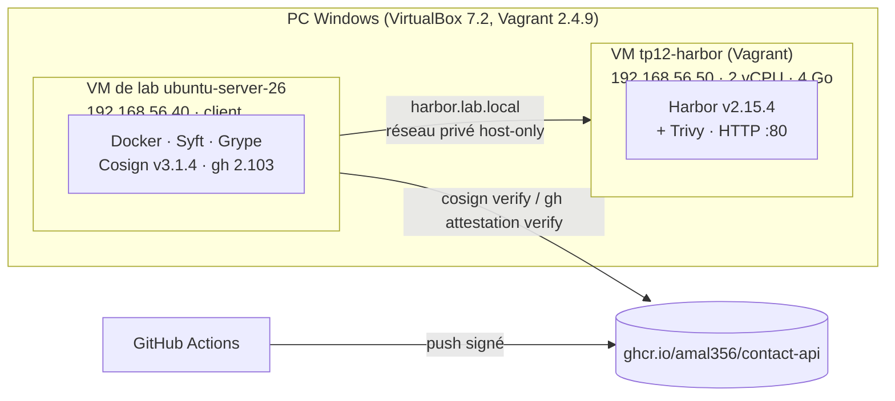

| Élément | Valeur |
|---|---|
| VM Harbor | créée par [`harbor-vm/Vagrantfile`](harbor-vm/Vagrantfile) : box `bento/ubuntu-24.04` (pas encore de box 26.04), 4 Go, IP privée `192.168.56.50` |
| Installation | [`harbor-vm/provision-harbor.sh`](harbor-vm/provision-harbor.sh) : Docker (dépôt officiel), Harbor v2.15.4 installeur en ligne, `--with-trivy` |
| Client | VM de lab : `/etc/hosts` → `192.168.56.50 harbor.lab.local`, `/etc/docker/daemon.json` → `"insecure-registries": ["harbor.lab.local"]` |
| Image | `contact-api:latest` (Node 24 Alpine, multi-stage, non-root) |

> En production un registre est **toujours** servi en HTTPS ; le mode HTTP n'est acceptable que dans ce lab isolé (réseau host-only, non routé).

---

## 2. Partie 1 – Installer Harbor

```powershell
cd "tp12\harbor-vm"
vagrant up          # crée la VM et lance provision-harbor.sh
```

Le script de provisionnement :

| Choix | Pourquoi |
|---|---|
| Empreinte **SHA-256** de `harbor-online-installer-v2.15.4.tgz` vérifiée avant extraction | on n'exécute pas un installeur non vérifié (`sha256sum -c` : **OK**) |
| `hostname: harbor.lab.local`, bloc `https:` commenté | HTTP seulement, pas de certificat dans le lab |
| Mots de passe admin et base **générés aléatoirement** (`openssl rand`) | jamais les valeurs par défaut `Harbor12345` / `root123`, jamais dans Git |
| `./install.sh --with-trivy` | scanner de vulnérabilités intégré |
| Trivy `timeout: 30m0s` | le 1er téléchargement de la base Trivy était trop lent (voir difficultés) |

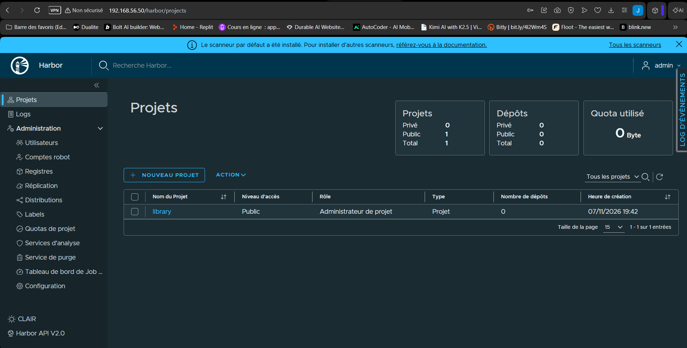

10 conteneurs `healthy` : `harbor-core`, `harbor-db`, `harbor-jobservice`, `harbor-log`, `harbor-portal`, `nginx`, `redis`, `registry`, `registryctl`, `trivy-adapter`.

---

## 3. Partie 2 – Projets, RBAC, scan et rétention

### Projet, utilisateurs, robot

| Élément | Configuration |
|---|---|
| Projet `devsecops` | **privé** |
| `dev1` | rôle **Développeur** (push + pull) |
| `audit1` | rôle **Invité** (pull seulement) |
| Robot `robot$devsecops+ci-push` | limité au projet, permissions **Dépôt : Push + Pull** uniquement, **expiration 30 jours** |

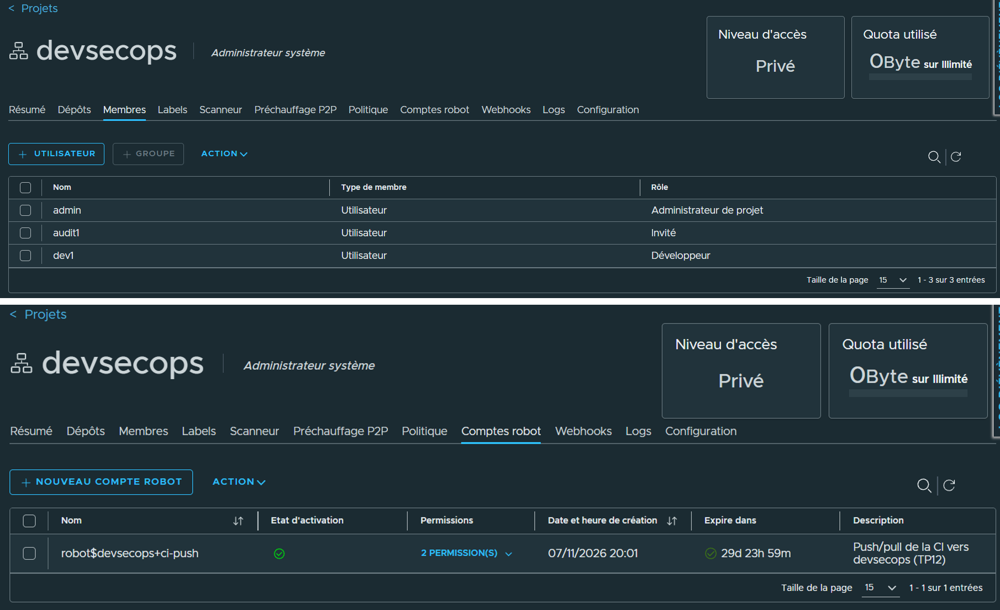

Push avec le robot, **sans que le secret soit affiché ni conservé** dans l'historique du shell :

```bash
read -rsp "Secret du robot : " ROBOT_SECRET; echo
echo "$ROBOT_SECRET" | docker login harbor.lab.local -u 'robot$devsecops+ci-push' --password-stdin && unset ROBOT_SECRET
docker tag contact-api:latest harbor.lab.local/devsecops/contact-api:1.0.0
docker push harbor.lab.local/devsecops/contact-api:1.0.0      # digest sha256:57ce7b6004cb…
docker logout harbor.lab.local                                # supprime l'identifiant stocké en clair
```

> Les apostrophes autour de `'robot$devsecops+ci-push'` sont indispensables : sans elles le shell remplace `$devsecops` par une variable vide.

### RBAC : `audit1` (Invité) tire mais ne pousse pas

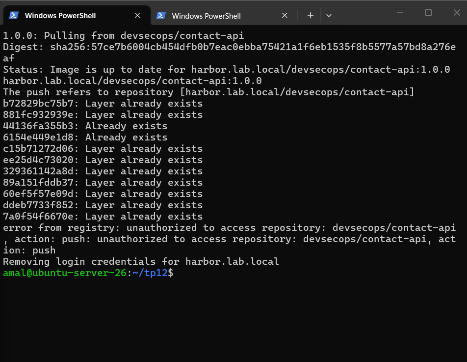

`docker pull` ✅ ; `docker push` ❌ `unauthorized to access repository: devsecops/contact-api, action: push` (formulation de Harbor 2.15 ; l'énoncé cite `denied: requested access to the resource is denied`, même sens).

### Scan automatique et blocage des images vulnérables

*devsecops → Configuration* : ✅ **Analyse automatique des images lors de l'envoi** · ✅ **Empêcher les images vulnérables de fonctionner**, seuil **Critique**.

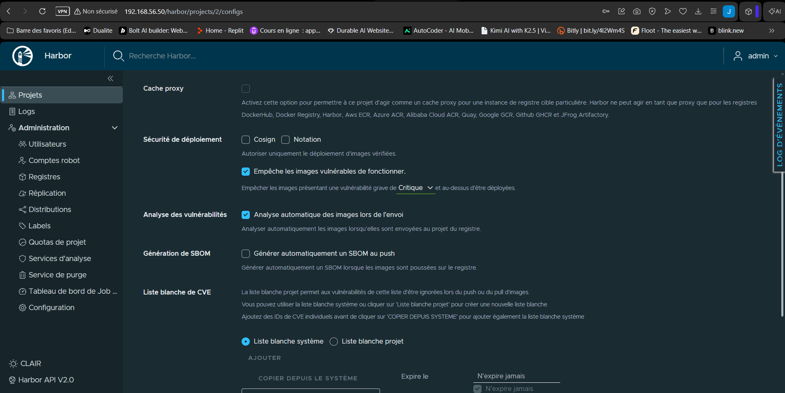

Image vulnérable : `node:14` (Debian 10, plus maintenue), c'est-à-dire la base de l'image du TP10 **avant correction**, sans l'ancien `Dockerfile` qui contenait un secret.

```bash
docker tag node:14 harbor.lab.local/devsecops/vuln-node14:tp10-avant
docker push harbor.lab.local/devsecops/vuln-node14:tp10-avant
docker pull harbor.lab.local/devsecops/vuln-node14:tp10-avant
```

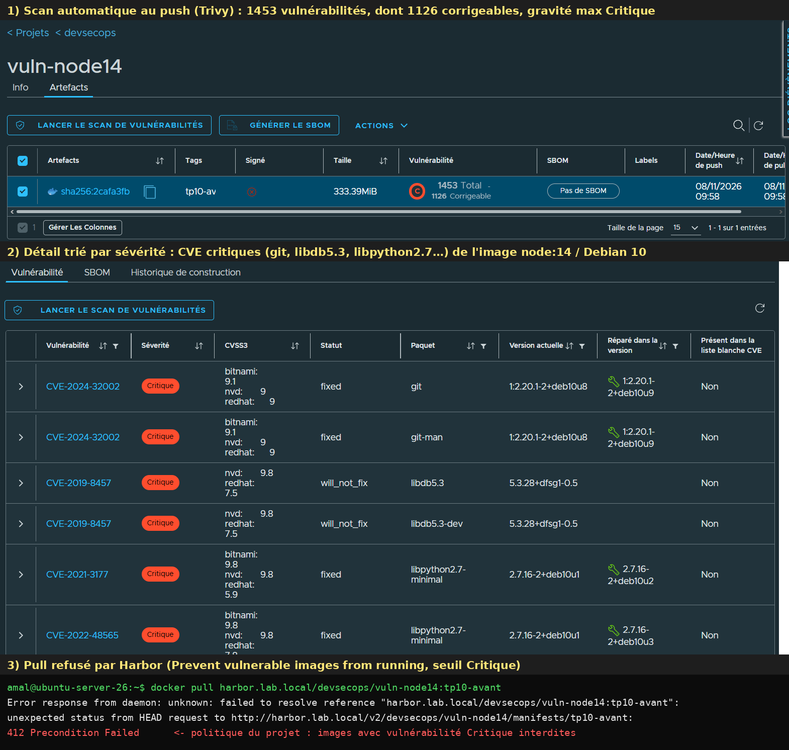

| | `vuln-node14:tp10-avant` | `contact-api:1.0.0` |
|---|---|---|
| Vulnérabilités | **1453** (1126 corrigeables) | 20 (toutes corrigeables) |
| Gravité max | **Critique** (ex. CVE-2024-32002 `git`, CVE-2019-8457 `libdb5.3` *will_not_fix*) | High (npm livré dans l'image `node`) |
| `docker pull` | ❌ **`412 Precondition Failed`** (politique du projet) | ✅ |

**Piège observé :** avant l'activation effective du scan, l'image avait été poussée **sans être analysée** (« Non analysé ») et son `pull` **avait réussi** : Harbor ne bloque que les vulnérabilités qu'il **connaît**. La politique de blocage n'a de valeur qu'avec le **scan automatique au push**.

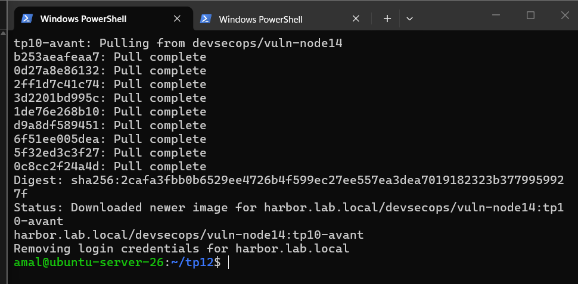

> CVE-2019-8457 est `will_not_fix` : Debian 10 n'est plus maintenue, la faille ne sera **jamais** corrigée dans cette image. La seule correction est de **changer d'image de base**, ce qui a été fait au TP10 (`node:24-alpine`).

### Rétention et immutabilité

Rétention : *Politique → Rétention des tags* : pour les dépôts `**`, **garder les 5 images les plus récemment poussées**, tags `**`, artefacts non tagués inclus. Sept versions `1.0.1`…`1.0.7` ont été poussées, chacune avec un `LABEL` différent pour obtenir **7 digests distincts** (Harbor raisonne par artefact, pas par tag) :

```bash
for i in 1 2 3 4 5 6 7; do
  printf 'FROM contact-api:latest\nLABEL tp12.build="%s"\n' "$i" | docker build -q -t harbor.lab.local/devsecops/contact-api:1.0.$i -
  docker push -q harbor.lab.local/devsecops/contact-api:1.0.$i
done
```

**TESTER L'EXÉCUTION** (dry run) : `contact-api` **5/8 conservées**, `1.0.0`, `1.0.1`, `1.0.2` marquées **DEL**, rien n'est supprimé (`Dry Run: true`).

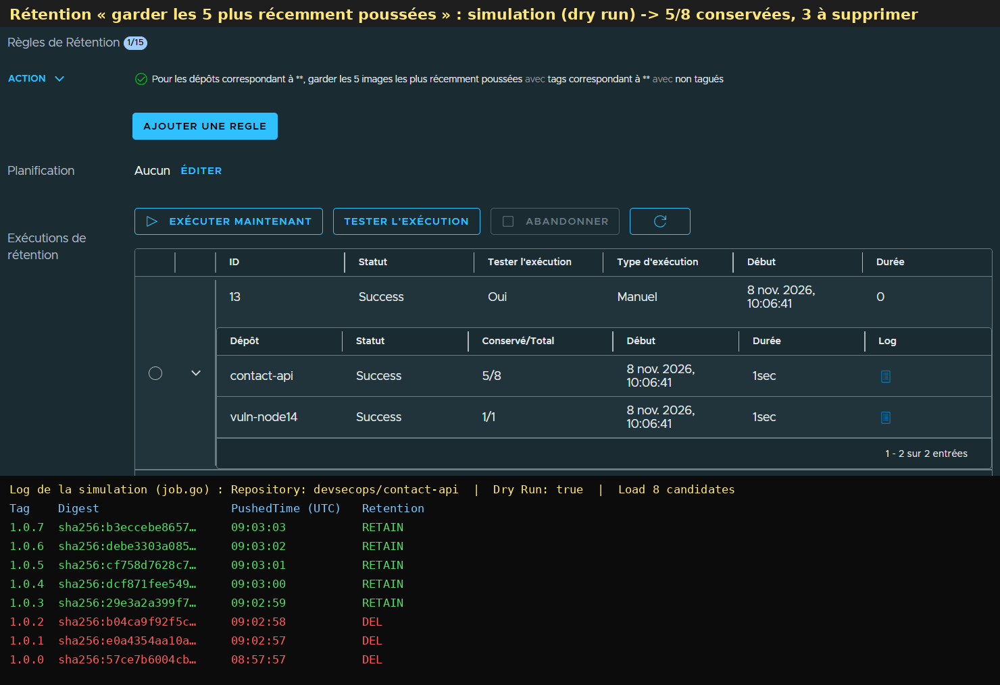

Immutabilité : *Politique → Immutabilité des tags* : dépôts `**`, tags **`v*`**. Un tag de release `v1.0.0` ne peut plus être réécrit (première protection contre l'attaque de la partie 6 ; les tags `1.0.x` du lab ne sont volontairement **pas** couverts, pour pouvoir simuler l'attaque).

### GitHub Container Registry ou Harbor ?

| Critère | GHCR (ghcr.io) | Harbor |
|---|---|---|
| Hébergement | SaaS GitHub | auto-hébergé (VM, Kubernetes) |
| RBAC | hérité des droits du dépôt / de l'organisation GitHub | projets, 5 rôles (admin, maintainer, developer, guest, limited guest), **robot accounts** à portée et durée limitées, LDAP/OIDC |
| Scan | aucun scan intégré (on scanne dans la CI : Trivy, Dependabot) | **Trivy intégré**, scan au push, **blocage du pull** selon la gravité |
| Signatures | stocke signatures et attestations Cosign / GitHub (OCI referrers) | stocke et **affiche** signatures et accessoires ; politique « déployer seulement des images signées » (Cosign / Notation) |
| Rétention / immutabilité | suppression manuelle ou par workflow | **politiques de rétention** (dry run) et **tags immuables** |
| Réplication | non | **réplication** push/pull entre registres, proxy cache (Docker Hub…) |
| Coût | gratuit pour le public, quota pour le privé | gratuit (open source CNCF), mais VM, stockage et maintenance à charge |
| Hors ligne | impossible | fonctionne en réseau isolé (base Trivy hors ligne, voir difficultés) |

**Bilan :** GHCR suffit pour un projet open source dont la CI est sur GitHub ; Harbor s'impose pour une entreprise qui veut garder ses images chez elle, imposer des règles de sécurité **au niveau du registre** (scan, blocage, signature, rétention) ou travailler hors ligne.

---

## 4. Partie 3 – SBOM avec Syft, scan avec Grype

```bash
docker run --rm -v /var/run/docker.sock:/var/run/docker.sock -v "$PWD:/out" anchore/syft:latest \
  contact-api:latest -o spdx-json=/out/contact-api.spdx.json -o cyclonedx-json=/out/contact-api.cdx.json
jq '.packages | length' contact-api.spdx.json
jq -r '.packages[] | select(.name=="express") | .versionInfo' contact-api.spdx.json
jq -r '.packages[] | select(.name|test("^(openssl|libssl3|libcrypto3)$")) | .name + " " + .versionInfo' contact-api.spdx.json
docker run --rm -v "$PWD:/in" anchore/grype:latest sbom:/in/contact-api.spdx.json
```

| Question | Réponse |
|---|---|
| SBOM produits | `contact-api.spdx.json` (684 Ko), `contact-api.cdx.json` (425 Ko) |
| Nombre de paquets | **250** (paquets Alpine + npm) |
| express | **5.3.0** |
| OpenSSL | **3.5.9-r0** (`libssl3`, `libcrypto3` : sur Alpine OpenSSL est livré sous ces noms) |

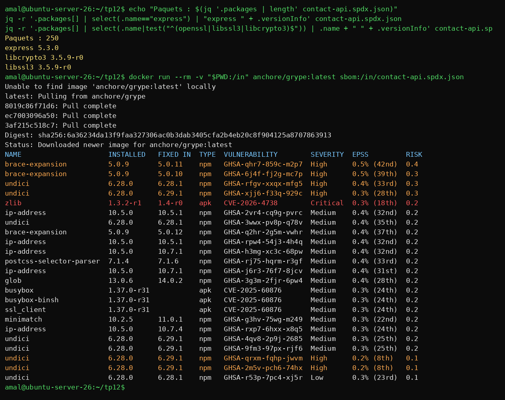

Grype, **sur le SBOM seul** (l'image n'est ni retéléchargée ni reconstruite) : **23 vulnérabilités**, 1 Critical (`zlib` 1.3.2-r1, CVE-2026-4738, corrigée en 1.4-r0), 8 High, 13 Medium, 1 Low. Les paquets npm (`undici`, `brace-expansion`, `glob`, `minimatch`, `ip-address`) sont surtout ceux du **npm livré dans l'image `node`**, pas les dépendances de `contact-api`.

> Intérêt : en conservant le SBOM de chaque release, on répond en quelques secondes à la question « suis-je concerné par la nouvelle CVE X ? ». Ici, le Trivy de Jenkins (TP10, build #11) ne voyait **aucune** Critical quelques heures plus tôt : base différente ou avis récent, d'où l'intérêt de **rescanner régulièrement** les SBOM conservés.

---

## 5. Partie 4 – Signer et vérifier avec Cosign (paire de clés)

```bash
cosign generate-key-pair      # cosign.key (privée, chiffrée par mot de passe, -rw-------) + cosign.pub
DIGEST=sha256:57ce7b6004cb454dfb0b7eac0ebba75421a1f6eb1535f8b5577a57bd8a276eaf
cosign sign   --key cosign.key --allow-http-registry --allow-insecure-registry -y harbor.lab.local/devsecops/contact-api@$DIGEST
cosign verify --key cosign.pub --allow-http-registry --allow-insecure-registry harbor.lab.local/devsecops/contact-api@$DIGEST
cosign verify --key cosign.pub --allow-http-registry --allow-insecure-registry harbor.lab.local/devsecops/contact-api:1.0.1
cosign attest --key cosign.key --type spdxjson --predicate contact-api.spdx.json \
  --allow-http-registry --allow-insecure-registry -y harbor.lab.local/devsecops/contact-api@$DIGEST
cosign verify-attestation --key cosign.pub --type spdxjson \
  --allow-http-registry --allow-insecure-registry harbor.lab.local/devsecops/contact-api@$DIGEST
```

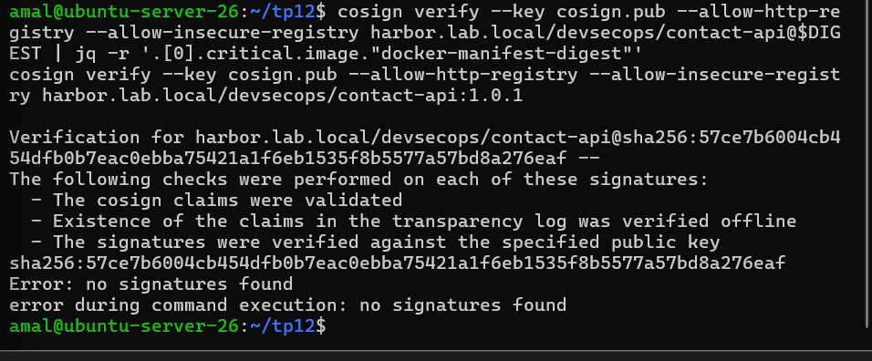

| Image | Résultat |
|---|---|
| `contact-api@sha256:57ce7b…` (signée) | ✅ *The signatures were verified against the specified public key* |
| `contact-api:1.0.1` (non signée) | ❌ `no signatures found` |

On signe **le digest**, pas le tag : un tag est une étiquette mobile, le digest est l'empreinte immuable du manifeste.

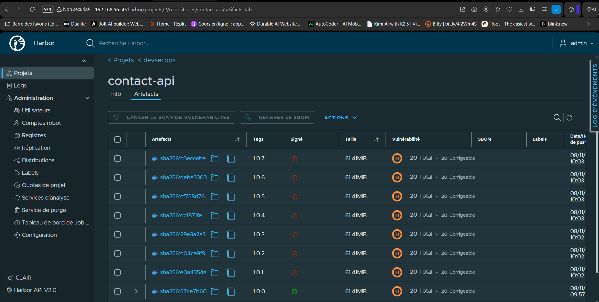

Dans Harbor, `1.0.0` affiche **Signé ✅** et une flèche vers ses **accessoires** (signature Cosign, attestation SBOM) ; `1.0.1`…`1.0.7` ne sont pas signées.

> `cosign.key` reste dans `~/tp12` de la VM : **jamais commitée** (le `.gitignore` du dépôt l'exclut). Même avec une clé, Cosign inscrit par défaut la signature dans le journal public **Rekor** (seule une empreinte y figure, pas l'image).

---

## 6. Partie 5 – Keyless et provenance dans GitHub Actions

Harbor n'est pas joignable depuis GitHub : cette partie publie dans **GHCR**. Workflow : [`.github/workflows/release.yml`](../.github/workflows/release.yml), déclenché par un tag `v*.*.*`.

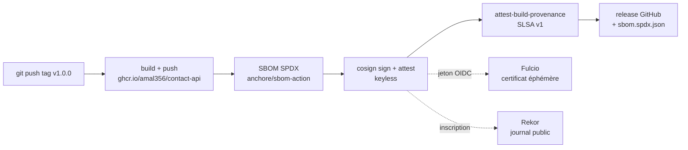

| Choix | Pourquoi |
|---|---|
| `permissions: {}` au niveau global ; `contents`, `packages`, `id-token`, `attestations` **en écriture** seulement pour le job | moindre privilège (TP10) |
| `id-token: write` | jeton **OIDC** qui prouve l'identité du workflow : **aucune clé n'est stockée** |
| 7 actions épinglées par **SHA complet** (checkout v7.0.1, setup-buildx v4.4.1, login v4.8.0, build-push v7.4.0, sbom v0.24.3, cosign-installer v4.1.3, attest-build-provenance v4.2.2) | un tag d'action peut être déplacé, pas un SHA |
| Signature et SBOM sur **`IMAGE@digest`** | jamais sur le tag |
| Image `ghcr.io/amal356/contact-api` | les noms d'images OCI sont en minuscules (`Amal356` refusé) |

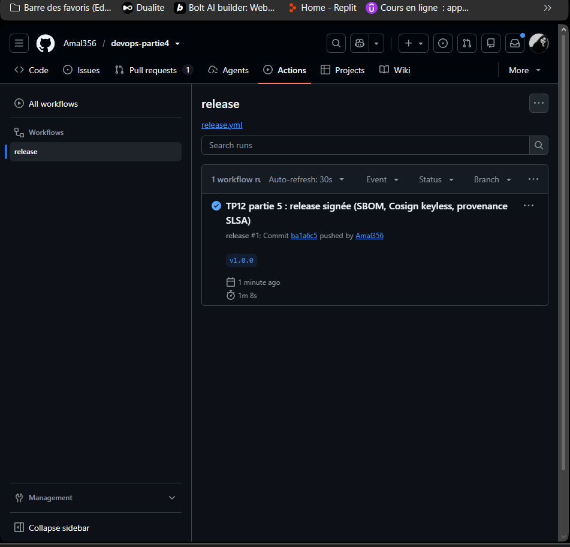

Run `release` #1 vert (1 min 8 s) ; release **contact-api v1.0.0** avec `sbom.spdx.json` ; image `ghcr.io/amal356/contact-api@sha256:7f3e8083…d991`.

Vérification depuis la VM (Cosign et `gh` installés **après vérification de leur empreinte SHA-256**) :

```bash
cosign verify ghcr.io/amal356/contact-api:v1.0.0 \
  --certificate-identity-regexp '^https://github.com/Amal356/devops-partie4/.*' \
  --certificate-oidc-issuer https://token.actions.githubusercontent.com
cosign verify ghcr.io/amal356/contact-api:v1.0.0 \
  --certificate-identity-regexp '^https://github.com/Amal356/vuln-app/.*' \
  --certificate-oidc-issuer https://token.actions.githubusercontent.com
gh attestation verify oci://ghcr.io/amal356/contact-api:v1.0.0 --owner Amal356
```

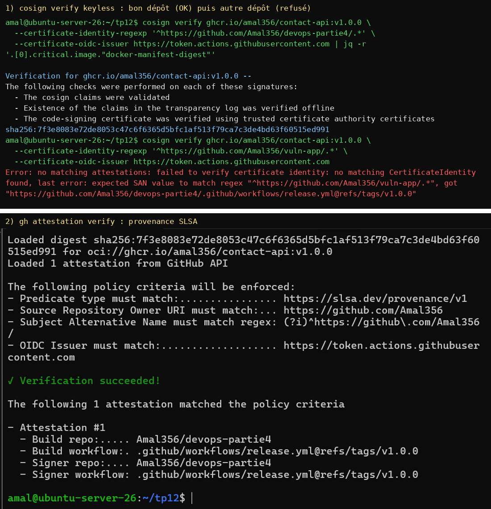

| Vérification | Résultat |
|---|---|
| `cosign verify`, identité `devops-partie4` | ✅ signature, journal Rekor, certificat Fulcio → `sha256:7f3e8083…` |
| `cosign verify`, identité `vuln-app` | ❌ `expected SAN value to match regex "^https://github.com/Amal356/vuln-app/.*", got "https://github.com/Amal356/devops-partie4/.github/workflows/release.yml@refs/tags/v1.0.0"` |
| `gh attestation verify` | ✅ **Verification succeeded!** prédicat `https://slsa.dev/provenance/v1`, *Build repo* `Amal356/devops-partie4`, *Build workflow* `.github/workflows/release.yml@refs/tags/v1.0.0` |

**Question : que se passe-t-il si `--certificate-identity-regexp` désigne un autre dépôt ?** La vérification **échoue**. En keyless, le certificat Fulcio contient l'identité exacte du signataire (dépôt, fichier de workflow, tag) dans son *SAN*. La signature ne prouve quelque chose que si l'on impose **qui** devait signer : sans cette contrainte (ou avec une regex trop large comme `.*`), une image signée par **n'importe quel** workflow GitHub, y compris celui d'un attaquant, serait acceptée.

---

## 7. Partie 6 – SLSA, in-toto et attaque simulée

### Niveaux SLSA v1.0 (Build track)

| Niveau | Exigence principale | Atteint par |
|---|---|---|
| Build L0 | aucune garantie | **(a) build sur le poste du développeur** : rien ne prouve d'où vient l'image |
| Build L1 | provenance existante (décrit comment l'artefact a été construit) | **(b) pipeline Jenkins** : build scripté et reproductible (`Jenkinsfile`, tag = SHA du commit, rapports archivés) mais **sans provenance** standard → **L0**, **L1** dès qu'on y génère une provenance |
| Build L2 | provenance **signée**, générée par une **plateforme hébergée** | **(c) workflow GitHub Actions avec `attest-build-provenance`** : provenance SLSA v1 signée par GitHub (Sigstore), vérifiable avec `gh attestation verify` → **L2** |
| Build L3 | plateforme de build **durcie**, provenance **infalsifiable par le projet** | pas atteint : il faudrait générer la provenance dans un **workflow réutilisable isolé** (ex. `slsa-github-generator`), hors de portée des étapes du projet |

### in-toto

in-toto décrit et vérifie **toute la chaîne de fabrication**. Le propriétaire publie un **layout** signé : la liste des **étapes** attendues (récupérer les sources, tester, construire, signer), **qui** a le droit de les exécuter (clés) et quels fichiers passent d'une étape à l'autre. Chaque étape produit un **link** signé (ses entrées, ses sorties, la commande lancée). Au moment de vérifier, on compare les links au layout : une étape manquante, exécutée par quelqu'un d'autre ou dont les produits ont été modifiés fait échouer la vérification. Les **attestations** de ce TP utilisent le format in-toto : `cosign attest` emballe le SBOM dans une *in-toto Statement* (sujet = digest de l'image, prédicat = SPDX) ; `attest-build-provenance` produit une *Statement* dont le prédicat est la **provenance SLSA**. Ce sont des links « simplifiés », vérifiables par `cosign verify-attestation` et `gh attestation verify`.

### Attaque simulée : image remplacée sous le même tag

```bash
# l'« attaquant » pousse une image modifiée sous le tag existant 1.0.0
printf 'FROM contact-api:latest\nRUN echo "porte derobee" > /tmp/backdoor\n' \
  | docker build -q -t harbor.lab.local/devsecops/contact-api:1.0.0 -
docker push -q harbor.lab.local/devsecops/contact-api:1.0.0
```

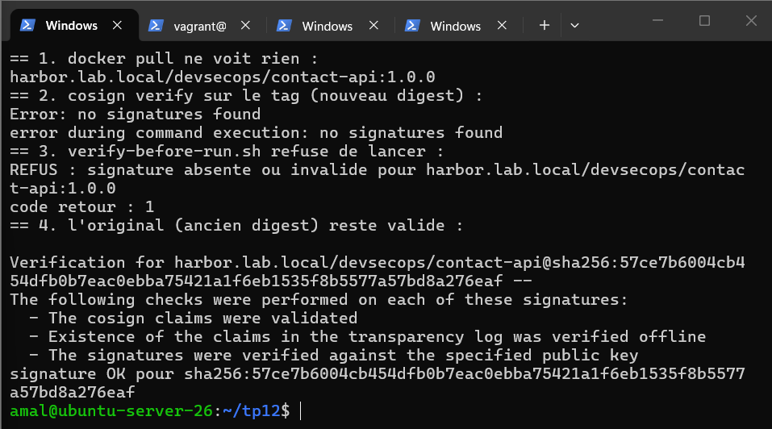

| Contrôle | Résultat |
|---|---|
| `docker pull …:1.0.0` | ✅ **réussi, aucune alerte** : Docker ne vérifie rien |
| `cosign verify …:1.0.0` (le tag pointe sur le **nouveau** digest) | ❌ `no signatures found` |
| `verify-before-run.sh …:1.0.0` | ❌ **REFUS**, code retour **1** : le conteneur n'est pas lancé |
| `cosign verify …@sha256:57ce7b…` (digest d'origine) | ✅ toujours signé |

L'attaque passe la barrière d'un simple `docker pull`, mais pas celle de la signature. Elle aurait aussi été **bloquée en amont** par l'**immutabilité des tags** si le tag avait suivi le motif `v*`.

### `verify-before-run.sh`

[`verify-before-run.sh`](verify-before-run.sh) refuse de lancer une image dont la signature n'est pas valide :

```bash
COSIGN_FLAGS="--allow-http-registry --allow-insecure-registry" ./verify-before-run.sh harbor.lab.local/devsecops/contact-api:1.0.0 --rm
```

1. `cosign verify --key cosign.pub` sur l'image demandée ; en cas d'échec : `REFUS` et **code retour 1** ;
2. il lance ensuite **le digest qui vient d'être vérifié** (`docker run repo@sha256:…`), jamais le tag : sinon le tag pourrait être déplacé **entre** la vérification et le lancement (attaque *TOCTOU*).

---

## 8. Livrables

| Fichier | Contenu | |
|---|---|---|
| `harbor-project.png` | projet privé `devsecops`, membres (`dev1` Développeur, `audit1` Invité), robot `ci-push` | ✅ |
| `harbor-rbac-denied.png` | push refusé pour `audit1` | ✅ |
| `harbor-scan.png` | rapport Trivy (1453 vulnérabilités, Critiques) et pull bloqué (412) | ✅ |
| `harbor-retention.png` | dry run : 5/8 conservées, 3 DEL | ✅ |
| `sbom-grype.png` | 250 paquets, express 5.3.0, OpenSSL 3.5.9, Grype sur le SBOM | ✅ |
| `cosign-verify.png` | vérification réussie puis `no signatures found` | ✅ |
| `keyless-provenance.png` | `cosign verify` keyless (bon / mauvais dépôt) et `gh attestation verify` | ✅ |
| `attack-detected.png` | image remplacée détectée par `cosign verify` et `verify-before-run.sh` | ✅ |
| `release.yml` | [`../.github/workflows/release.yml`](../.github/workflows/release.yml) | ✅ |
| `verify-before-run.sh` | [`verify-before-run.sh`](verify-before-run.sh) | ✅ |
| Tableau SLSA, comparaison GHCR / Harbor | sections 7 et 3 | ✅ |
| VM Harbor reproductible | [`harbor-vm/`](harbor-vm/) (Vagrantfile, provisionnement, base Trivy hors ligne) | ✅ |

> **Défis non réalisés (facultatifs) :** réplication Harbor depuis Docker Hub (proxy cache) et signature Cosign depuis la CI avec la clé en secret (`COSIGN_PRIVATE_KEY`, `COSIGN_PASSWORD`). La partie 5 montre l'alternative préférable : **aucune clé à stocker** grâce au keyless.

---

## 9. Difficultés rencontrées

| Problème | Cause | Solution |
|---|---|---|
| `vagrant up` : *Timed out while waiting for the machine to boot* | 1er démarrage lent, deux VM en parallèle | `boot_timeout = 900`, `vagrant halt -f` puis `vagrant up --provision` |
| Collision de port SSH 2222 | port déjà pris par la VM de lab | Vagrant bascule seul sur 2200 (sans effet : `vagrant ssh`) |
| Téléchargement de Cosign `FAILED` à `sha256sum -c` | téléchargement **tronqué** (45 Mo sur 145) par une coupure réseau | reprise `curl -C -` ; c'est la vérification d'empreinte qui a empêché d'installer un binaire incomplet |
| `gh attestation` inconnu | `gh` 2.46 d'Ubuntu trop ancien (commande apparue en 2.49) | `gh` 2.103.3 officiel, empreinte vérifiée |
| Image analysée « Non analysé », pull autorisé | scan au push pas encore enregistré ; seuil laissé sur « Bas » | case cochée **et ENREGISTRÉE**, seuil **Critique**, scan relancé |
| Scan Trivy en échec : `context deadline exceeded` puis `PROTOCOL_ERROR` | la base Trivy (`ghcr.io/aquasecurity/trivy-db:2`, 132 Mo) ne se téléchargeait pas d'un bloc sur une connexion instable | timeout 30 min, puis [`trivy-db-offline.sh`](harbor-vm/trivy-db-offline.sh) : téléchargement de la couche OCI **avec reprise**, **vérification du digest SHA-256**, copie de `trivy.db` + `metadata.json` dans le cache de `trivy-adapter`, `skip_update: true` (**mode hors ligne**, méthode documentée par Harbor) ; scans ensuite en quelques secondes |
| Connexion admin refusée après redémarrage | Harbor n'utilise `harbor_admin_password` qu'à la **1re** installation (`Admin password from config ignored: password already exists in database`) ; le mot de passe avait été changé dans l'interface | réinitialisation de Harbor avec un nouveau mot de passe choisi, puis recréation du projet et du robot |
| `docker push` vers `https://…:443` refusé | commandes lancées dans la **VM Harbor** au lieu de la VM de lab (seule configurée en `insecure-registries`) | toujours vérifier l'invite : `amal@ubuntu-server-26` = client, `vagrant@harbor` = serveur |
| `read -s` « mangeait » la ligne suivante | bloc collé d'un coup : `read` prend la ligne suivante comme saisie | coller `read` seul, puis le reste |
| Pull bloqué affiché comme `412 Precondition Failed` | Docker récent n'affiche pas le message détaillé de la politique | le code 412 est la réponse de Harbor à une image qui viole la politique du projet |

## Sécurité

- **Aucun secret dans le dépôt** : ni `cosign.key`, ni secret du robot, ni mot de passe Harbor (générés aléatoirement, saisis avec `read -s`, transmis par `--password-stdin`) ; `docker logout` après chaque usage (identifiants stockés en clair dans `~/.docker/config.json`).
- **Moindre privilège** : robot limité à un projet, Push + Pull uniquement, **expiration 30 jours** ; `audit1` en lecture seule ; workflow `release` avec `permissions: {}` par défaut.
- **Intégrité vérifiée partout** : installeur Harbor, Cosign, `gh` et base Trivy installés **après vérification SHA-256** ; images signées et vérifiées **par digest** ; actions GitHub épinglées par SHA.
- **Keyless** en CI : aucune clé longue durée à protéger ; identité du workflow imposée à la vérification.
- **Registre** : projet privé, scan au push, blocage des images Critiques, tags `v*` immuables, rétention testée en dry run avant toute suppression.
- Harbor en **HTTP** uniquement parce que le réseau du lab est isolé (host-only) ; en production : HTTPS obligatoire.
- Jeton `gh` stocké en clair dans la VM (`~/.config/gh/hosts.yml`, pas de trousseau) : `gh auth logout` en fin de TP.
