# TP9 – Pipeline as Code avec Jenkins

**Étudiante :** Amal Jemli – Master DevOps et Cloud Computing (2026/2027)
**Énoncé :** [TP9 : Pipeline as Code avec Jenkins](https://docs.teknolabs.net/courses/devops-cloud/partie-4-cicd-devsecops/tp9-jenkins-pipeline/)

Objectif : décrire toute la chaîne d'intégration de l'API `contact-api` (TP8) dans un **`Jenkinsfile` déclaratif** versionné avec le code : installation et tests dans des **agents Docker**, étapes **en parallèle**, **rapport JUnit**, image Docker **taguée au SHA Git** et poussée sur Docker Hub avec des **credentials masqués**, puis un **pipeline Multibranch** qui construit chaque branche et chaque Pull Request.

Le `Jenkinsfile` de fin de TP9 est conservé dans ce dossier : [`Jenkinsfile`](Jenkinsfile).
Depuis le TP10, celui de la racine du dépôt ([`../Jenkinsfile`](../Jenkinsfile)) contient en plus les stages de sécurité `Security` (Gitleaks, Semgrep, npm audit) et `Image scan` (Trivy) : voir le [README du TP10](../tp10-devsecops/README.md#8-partie-6--quality-gates-de-sécurité-dans-jenkins).

---

## Sommaire

1. [Environnement](#1-environnement)
2. [Partie 1 – Premier pipeline](#2-partie-1--premier-pipeline)
3. [Partie 2 – Agents Docker, parallélisme et JUnit](#3-partie-2--agents-docker-parallélisme-et-junit)
4. [Partie 3 – Image taguée au SHA Git, credentials et push](#4-partie-3--image-taguée-au-sha-git-credentials-et-push)
5. [Partie 4 – Multibranch Pipeline](#5-partie-4--multibranch-pipeline)
6. [Le Jenkinsfile final](#6-le-jenkinsfile-final)
7. [Livrables](#7-livrables)
8. [Difficultés rencontrées](#8-difficultés-rencontrées)

---

## 1. Environnement

| Élément | Valeur |
|---|---|
| VM | `ubuntu-server-26` – Ubuntu Server 26.04.1 LTS, 3,3 Go de RAM, disque 48 Go, host-only `192.168.56.40` |
| Jenkins | **2.580.1** (installation native du TP4, service `jenkins`, port 8080) |
| Docker | 29.8 – l'utilisateur `jenkins` est membre du groupe `docker` |
| Plugins | Pipeline, Git, GitHub Branch Source, Docker Pipeline, JUnit, Credentials Binding, Workspace Cleanup, Timestamper, Pipeline Graph View |
| Application | `contact-api` du TP8 (Express 5, Zod, Helmet, rate limit, 24 tests Vitest), avec le `Dockerfile` multi-stage du TP7 |
| Registre | Docker Hub, dépôt `amal878/contact-api` |

```bash
systemctl is-active jenkins ; dpkg -l jenkins | tail -1 ; id jenkins ; free -h
```

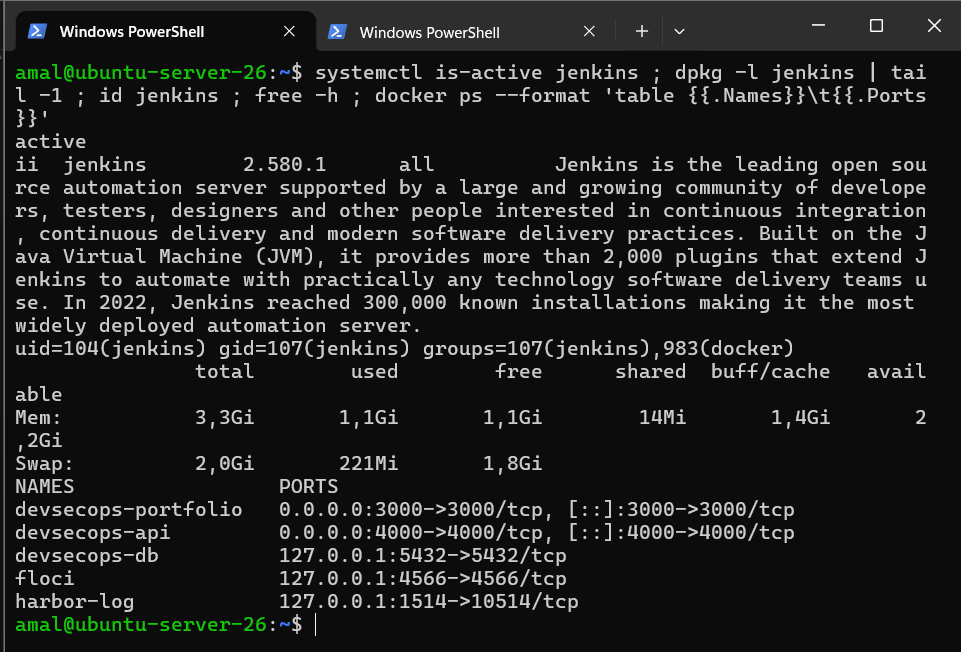

> La VM n'est pas joignable depuis Internet : pas de webhook GitHub. Les builds sont lancés à la main (partie 1 à 3) ou par un **scan périodique** du dépôt (partie 4).

### Préparation du dépôt

Les quatre TP de la partie 4 font évoluer la même application : `contact-api` est à la **racine** du dépôt (le `Jenkinsfile` doit y être) et chaque TP a son dossier (`tp9-jenkins/`, …) pour le README et les captures.

- copie des seuls fichiers suivis par Git du TP8 (`git ls-files | tar …`) : ni `node_modules`, ni `.env` ;
- `Dockerfile` multi-stage (dépendances de production, utilisateur `node`, `HEALTHCHECK`) et `.dockerignore` ;
- **ESLint** (configuration « flat » `eslint.config.js`, règle `no-unused-vars` avec `ignoreRestSiblings`) et script `npm run lint`.

```bash
npm run lint && echo "LINT OK" && npm test 2>&1 | tail -5
```

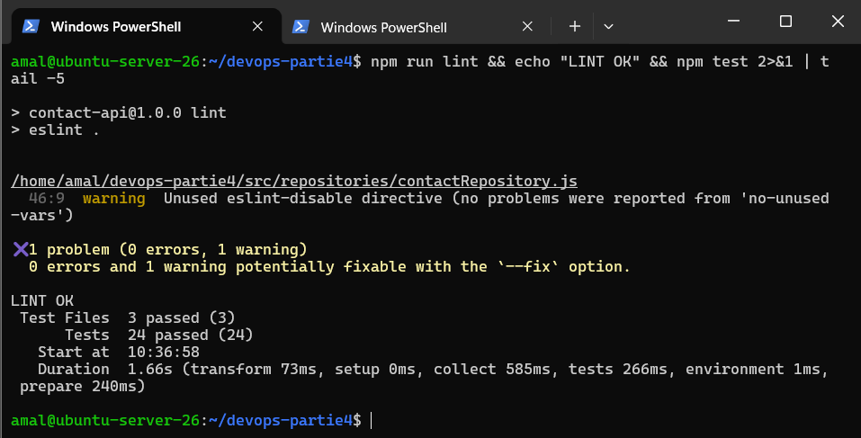

---

## 2. Partie 1 – Premier pipeline

Le squelette fourni est copié à la racine, `IMAGE_NAME` est remplacé par `amal878/contact-api` et le stage `Quality` lance `npm run lint` puis `npm test`.

Job **Pipeline** `contact-api` : *Pipeline script from SCM* → Git → `https://github.com/Amal356/devops-partie4.git` → branche `*/main` → *Script Path* `Jenkinsfile`.

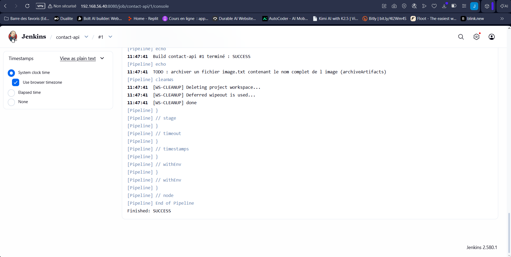

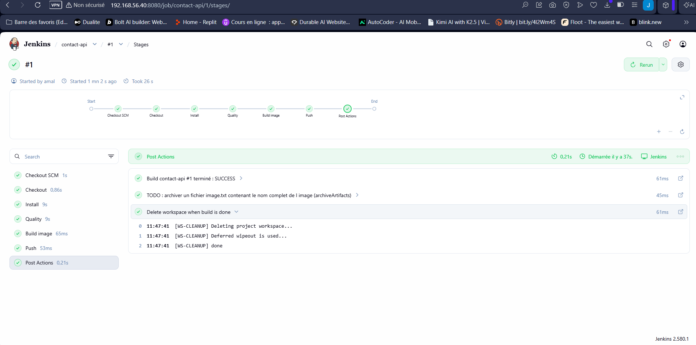

Build **#1 : SUCCESS en 26 s**. Les options du squelette sont visibles : horodatage de chaque ligne (`timestamps()`), workspace vidé en fin de build (`cleanWs()`).

---

## 3. Partie 2 – Agents Docker, parallélisme et JUnit

| Exigence | Mise en œuvre |
|---|---|
| Agent `node:24-alpine` | `agent { docker { image 'node:24-alpine'; args '-e HOME=/tmp'; reuseNode true } }` sur `Install`, `Lint` et `Unit tests` |
| `reuseNode true` | le conteneur monte le **même workspace** : `node_modules` installé dans `Install` est réutilisé par les stages suivants |
| Parallélisme | `Quality` contient un bloc `parallel` : **`Lint`** et **`Unit tests`** s'exécutent en même temps |
| Rapport JUnit | script `test:ci` (`vitest … --reporter=junit --outputFile.junit=reports/junit.xml`) publié par `junit` dans `post { always }` |
| Pas de builds concurrents | `disableConcurrentBuilds()` dans `options` |

> Node.js vient désormais de l'image Docker et non de la VM : le build est reproductible sur n'importe quel agent qui dispose de Docker.
> `HOME=/tmp` : Jenkins lance le conteneur avec son propre UID (`-u 104:107`), qui n'a pas de dossier personnel dans l'image ; sans cette variable, `npm ci` échoue (`EACCES … mkdir '/.npm'`).

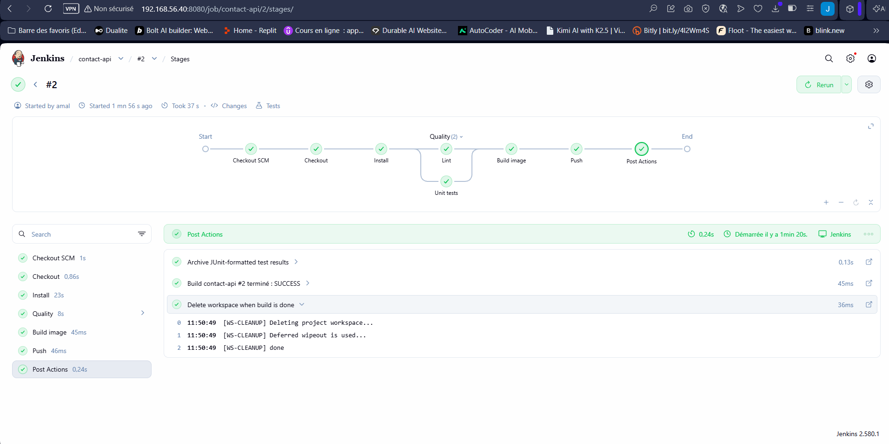

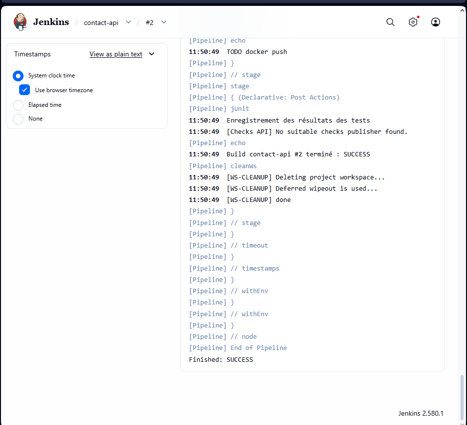

### Test volontairement en échec

Une assertion est modifiée (`toBe(201)` → `toBe(200)`) puis poussée :

```bash
sed -i '0,/toBe(201)/s//toBe(200)/' tests/contact.test.js
git commit -am "TP9 : test volontairement en échec (démonstration)" && git push
```

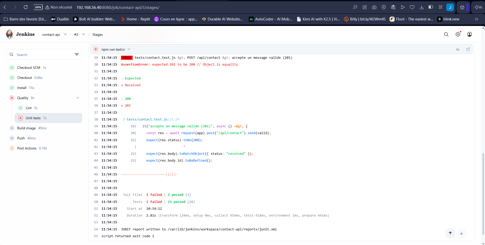

- `Unit tests` est en **rouge** : `AssertionError: expected 201 to be 200` – **1 failed | 23 passed** ;
- `Lint`, lancé en parallèle, va **jusqu'au bout** (vert) ;
- `Build image` et `Push` sont **sautés** (`»`) : une image n'est jamais construite à partir d'un code dont les tests échouent ;
- le bloc **`failure`** s'exécute : *« Le pipeline a échoué : consultez les logs du stage en rouge. »*

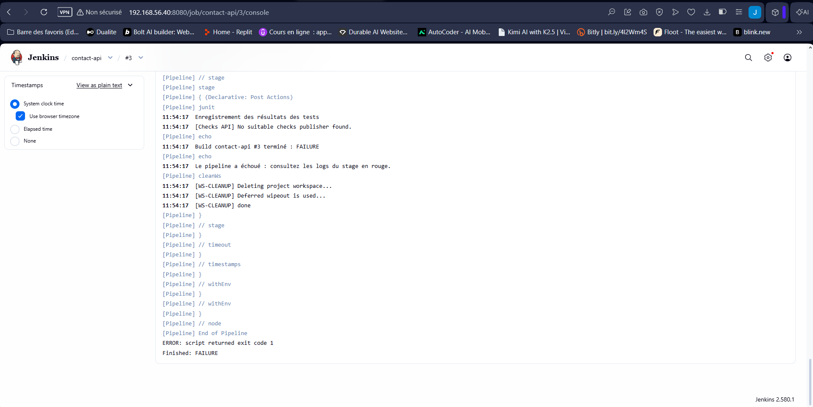

Le graphique **Résultats des tests** de la page du job montre l'échec apparu au build #3 :

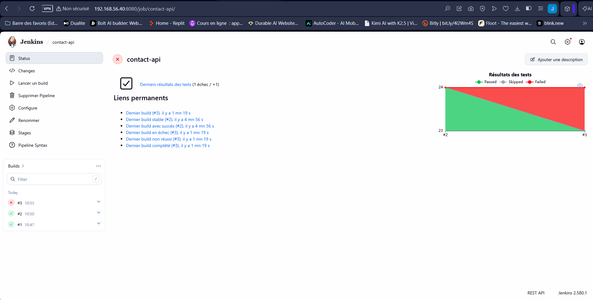

Correction par `git revert --no-edit HEAD` : le build #4 redevient vert.

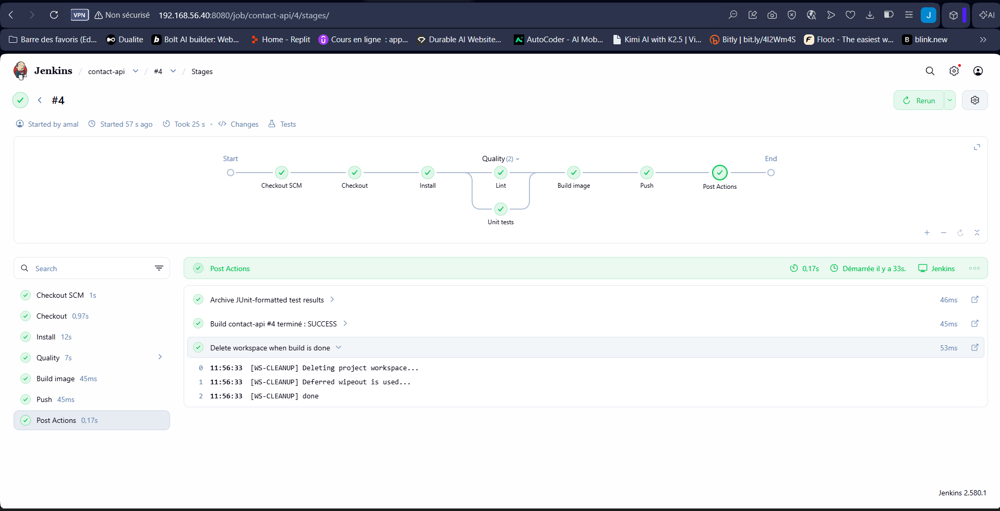

---

## 4. Partie 3 – Image taguée au SHA Git, credentials et push

### Credential Docker Hub

Un **token d'accès personnel** Docker Hub (*Read & Write*), et non le mot de passe du compte, est enregistré dans Jenkins : *Manage Jenkins → Credentials → System → Global*, type *Username with password*, ID **`dockerhub`**. Il peut être révoqué à tout moment sans changer le mot de passe.

### Tag immuable et traçabilité

```groovy
stage('Checkout') {
  steps {
    checkout scm
    script { env.SHORT_SHA = env.GIT_COMMIT.take(7) }
  }
}
stage('Build image') {
  steps {
    sh '''
      docker build \
        --label org.opencontainers.image.revision="$GIT_COMMIT" \
        --label org.opencontainers.image.source="https://github.com/Amal356/devops-partie4" \
        -t "$IMAGE_NAME:$SHORT_SHA" .
      echo "$IMAGE_NAME:$SHORT_SHA" > image.txt
    '''
  }
}
```

- le tag `<sha>` est **immuable** : une image correspond à un commit et un seul, contrairement à `latest` ;
- le label OCI `org.opencontainers.image.revision` contient le SHA **complet** : on retrouve le commit exact à partir de l'image (`docker inspect`).

### Push uniquement sur `main`

```groovy
stage('Push') {
  when {
    anyOf {
      branch 'main'                                   // job Multibranch : BRANCH_NAME = 'main'
      expression { env.GIT_BRANCH == 'origin/main' }  // job Pipeline simple : pas de BRANCH_NAME
    }
  }
  steps {
    withCredentials([usernamePassword(credentialsId: 'dockerhub',
                      usernameVariable: 'DH_USER', passwordVariable: 'DH_TOKEN')]) {
      sh 'echo "$DH_TOKEN" | docker login -u "$DH_USER" --password-stdin'
      sh 'docker push "$IMAGE_NAME:$SHORT_SHA"'
      sh 'docker tag "$IMAGE_NAME:$SHORT_SHA" "$IMAGE_NAME:latest-main" && docker push "$IMAGE_NAME:latest-main"'
    }
  }
  post { always { sh 'docker logout || true' } }
}
```

> **Pourquoi `anyOf` ?** `when { branch 'main' }` s'appuie sur la variable `BRANCH_NAME`, qui n'existe que dans un job **Multibranch**. Dans le job *Pipeline* simple des parties 1 à 3, elle est absente et le `Push` serait toujours sauté ; la seconde condition (`GIT_BRANCH == 'origin/main'`) couvre ce cas.

> **Pourquoi des guillemets simples ?** Avec `sh '…$DH_TOKEN…'`, c'est le **shell** qui lit la variable : le secret n'est jamais interpolé par Groovy, n'apparaît pas dans le script généré et Jenkins peut le masquer. `--password-stdin` évite qu'il apparaisse dans la liste des processus (`ps`). `docker logout` supprime l'identifiant de `~jenkins/.docker/config.json`.

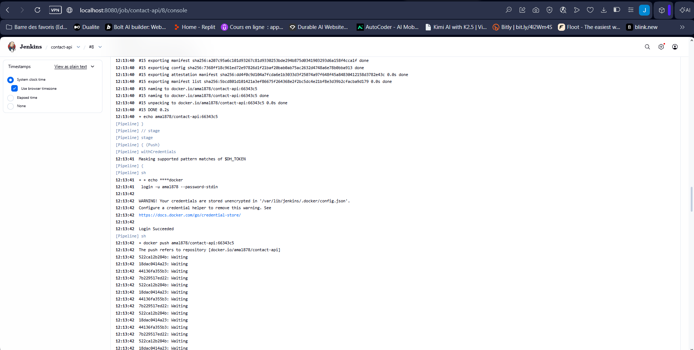

`Masking supported pattern matches of $DH_TOKEN`, puis `echo ****` : le token est remplacé par `****` ; `Login Succeeded`, puis `docker push amal878/contact-api:66343c5`.

### `image.txt` archivé

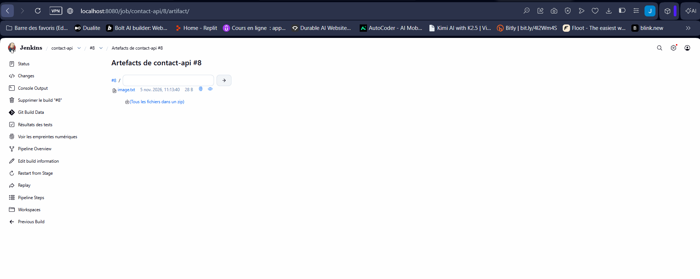

`archiveArtifacts artifacts: 'image.txt', fingerprint: true` : la référence complète de l'image (28 octets, `amal878/contact-api:66343c5`) est téléchargeable depuis la page du build et son empreinte permet de suivre l'artefact entre builds.

### Vérification : tag Docker Hub = SHA Git

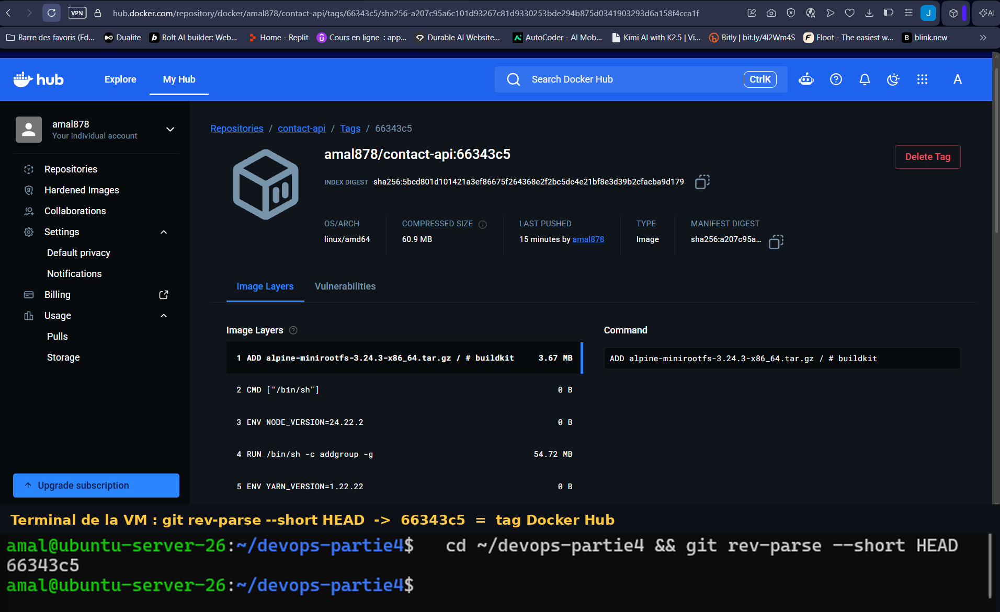

`amal878/contact-api:66343c5` sur Docker Hub et `git rev-parse --short HEAD` → `66343c5` dans la VM. L'image fait **60,9 Mo** compressée et repose sur **alpine 3.24.3** (Dockerfile multi-stage). Le tag `latest-main` désigne le même manifest (`sha256:a207c95a…`).

---

## 5. Partie 4 – Multibranch Pipeline

### Credential GitHub en lecture seule

**Fine-grained personal access token** limité au seul dépôt `Amal356/devops-partie4`, en **lecture seule** : *Contents*, *Pull requests*, *Commit statuses* (+ *Metadata*, obligatoire). ID Jenkins : `github-pat`. Principe du moindre privilège : Jenkins peut lire le code et les PR, mais ne peut rien modifier.

### Job Multibranch

*New Item* → `contact-api-multibranch` → **Multibranch Pipeline** → source **GitHub** (`github-pat`, `https://github.com/Amal356/devops-partie4`).

- **Discover branches : All branches** – la stratégie par défaut (*Exclude branches that are also filed as PRs*) ne construit que `PR-1` et pas la branche `feature/…` ;
- **Discover pull requests from origin** ;
- **Scan Multibranch Pipeline Triggers** : *Periodically if not otherwise run*, **2 minutes** (remplace le webhook, impossible ici).

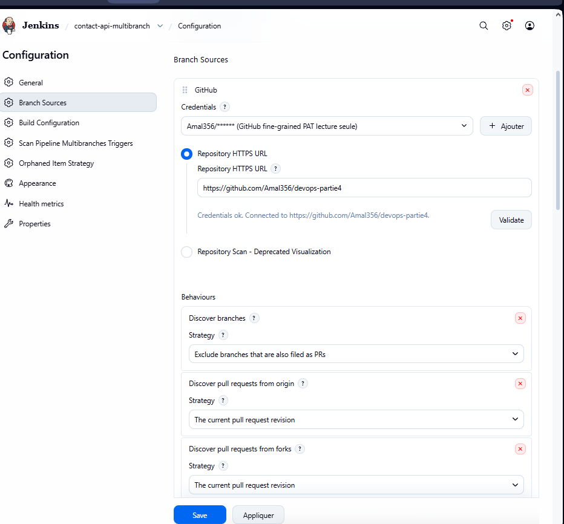

### Branche et Pull Request

La branche `feature/rate-limit-config` rend la limite de débit **configurable** (au lieu de la valeur 5 écrite en dur) :

```js
limit: Number(process.env.RATE_LIMIT_MAX ?? 5), // configurable, 5 req/min par défaut
```

```bash
git checkout -b feature/rate-limit-config
# modification de src/app.js et de .env.example (RATE_LIMIT_MAX=5)
git commit -am "feat: limite de débit configurable (RATE_LIMIT_MAX) ..."
git push -u origin feature/rate-limit-config
```

Pull Request **#1** ouverte sur GitHub (`feature/rate-limit-config` → `main`, aucun conflit) :

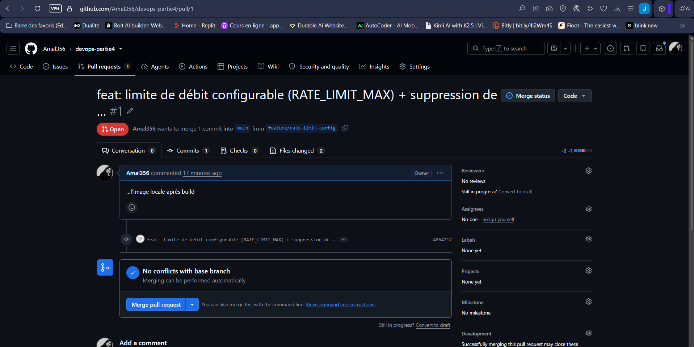

Le scan du dépôt découvre automatiquement les deux branches et la Pull Request, chacune avec son `Jenkinsfile` :

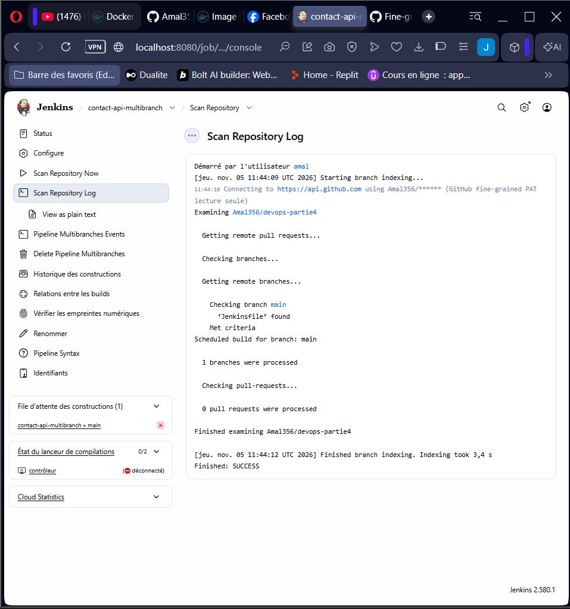

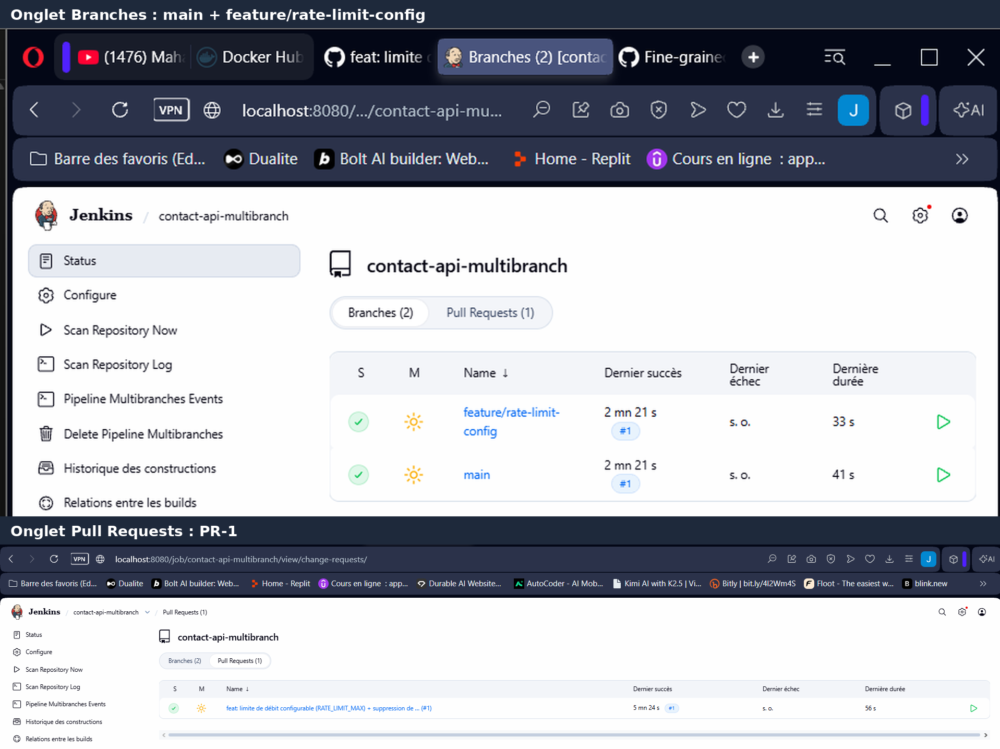

### `Push` sauté sur la branche et la PR, exécuté sur `main`

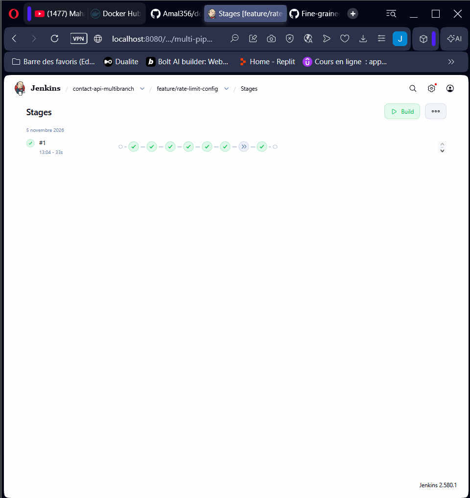

Après **merge** de la PR, le scan détecte le nouveau commit de `main` et lance `main #2`, dont le stage `Push` est exécuté :

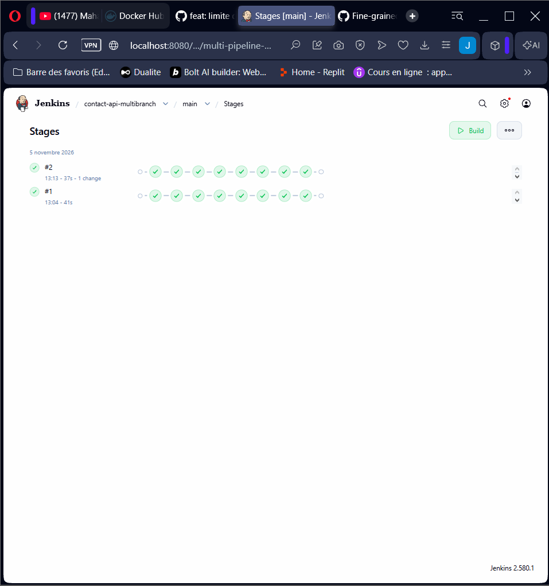

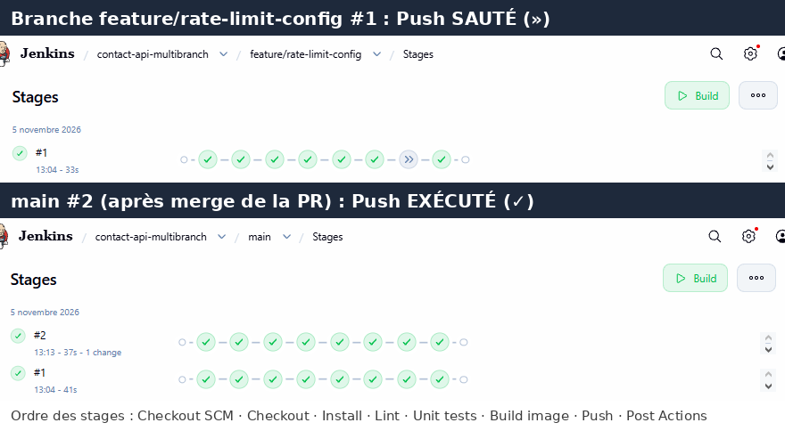

| Job | `BRANCH_NAME` | `Build image` | `Push` |
|---|---|---|---|
| `feature/rate-limit-config` #1 | `feature/rate-limit-config` | ✅ | **sauté** |
| `PR-1` #1 | `PR-1` | ✅ | **sauté** |
| `main` #2 (après merge) | `main` | ✅ | **exécuté** |

Une branche ou une PR est **testée et construite** (on vérifie que l'image se construit), mais seule `main` **publie** une image : le registre ne contient que du code relu et fusionné.

---

## 6. Le Jenkinsfile final

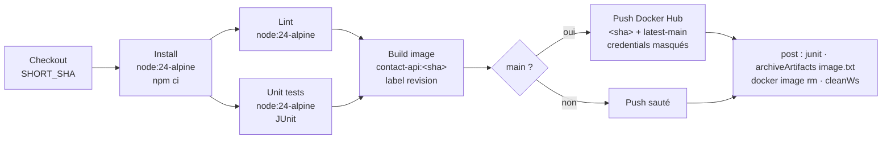

Points complémentaires :

| Option / bloc | Rôle |
|---|---|
| `timestamps()` | horodatage de chaque ligne de log |
| `timeout(time: 20, unit: 'MINUTES')` | un build bloqué ne monopolise pas l'exécuteur |
| `buildDiscarder(logRotator(numToKeepStr: '10'))` | seuls les 10 derniers builds sont conservés (disque) |
| `disableConcurrentBuilds()` | un seul build à la fois par branche |
| `post { always { junit … } }` | `allowEmptyResults: true` : pas d'erreur supplémentaire si le build échoue avant les tests |
| `post { failure { … } }` | message explicite en cas d'échec |
| `post { cleanup { … } }` | suppression de l'image locale (`docker image rm … \|\| true`) puis `cleanWs()` : la VM ne se remplit plus d'images après chaque build |

---

## 7. Livrables

| Fichier | Contenu | |
|---|---|---|
| `pipeline-stages.png` | stages avec `Lint` et `Unit tests` en parallèle | ✅ |
| `junit-report.png` | résultats des tests avec un test en échec, puis corrigé (`06-build-corrige.png`) | ✅ |
| `credentials-masked.png` | console avec le token affiché `****` | ✅ |
| `dockerhub-sha-tag.png` | image `contact-api:66343c5` sur Docker Hub + `git rev-parse --short HEAD` | ✅ |
| `multibranch.png` | jobs `main`, `feature/rate-limit-config` et `PR-1` | ✅ |
| `shared-library.png` | *(défi, facultatif)* | non réalisé |
| `Jenkinsfile` | à la racine du dépôt | ✅ |

> **Défis non réalisés.** La *Shared Library* (`vars/buildAndPush.groovy`) permettrait de factoriser `docker build` / `docker push` entre plusieurs projets. Le plugin *GitHub Checks* afficherait le résultat du build dans la PR : l'onglet **Checks** de la PR #1 affiche aujourd'hui `0`, car Jenkins ne renvoie pas son statut à GitHub (le token est d'ailleurs en lecture seule).

---

## 8. Difficultés rencontrées

| Problème | Cause | Solution |
|---|---|---|
| Port 4000 occupé, RAM limitée | conteneurs d'autres projets (`devsecops-*`, `floci`, `harbor-log`) redémarrés au boot | `docker stop` de ces conteneurs pendant le TP |
| Builds #5 et #6 exécutés avec l'ancien `Jenkinsfile` (`TODO docker build`) | le nouveau fichier n'avait pas encore été copié dans la VM et poussé | vérification avec `grep -c withCredentials Jenkinsfile` avant chaque commit |
| Build #7 : `Could not find credentials entry with ID 'dockerhub'` | credential pas encore créé | création du credential `dockerhub` avec un token Docker Hub |
| Nœud `contrôleur` **déconnecté**, builds bloqués en file d'attente | disque de la VM plein à **99 %** (808 Mo libres) : Jenkins coupe le nœud sous le seuil d'espace libre | `docker builder prune -af` + `docker image prune -af` (**7,6 Go** libérés, 12 Go libres) ; redémarrage de Jenkins ; suppression de l'image locale en fin de build dans le `Jenkinsfile` |
| Job Multibranch créé pendant que le disque était plein | builds `main #1` et `PR-1 #1` restés bloqués (`Unexpected exception in CPS VM thread`) | suppression puis recréation du job une fois le disque libéré |
| Pas de job `feature/rate-limit-config` | stratégie par défaut *Exclude branches that are also filed as PRs* | *Discover branches : All branches* |
| `npm warn … 11 vulnerabilities` pendant `npm ci` | dépendances de développement du starter | traité au **TP10** : `npm audit --omit=dev` bloque le pipeline à partir de *high* (elles sont toutes dans les outils de développement) ; une vraie faille de `zod` a ensuite été bloquée puis corrigée (`zod` 4.6.7) |

## Sécurité

- Aucun secret dans le dépôt ni dans le `Jenkinsfile` : seulement les **ID** des credentials (`dockerhub`, `github-pat`).
- Token Docker Hub et token GitHub **dédiés**, révocables, à durée limitée ; token GitHub limité à un seul dépôt et en lecture seule.
- Secrets masqués dans les logs, passés par `--password-stdin`, `docker logout` après chaque push.
- Seule la branche `main` publie une image ; les branches et PR sont uniquement construites et testées.
